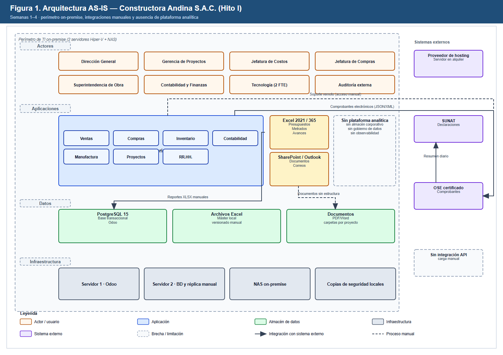
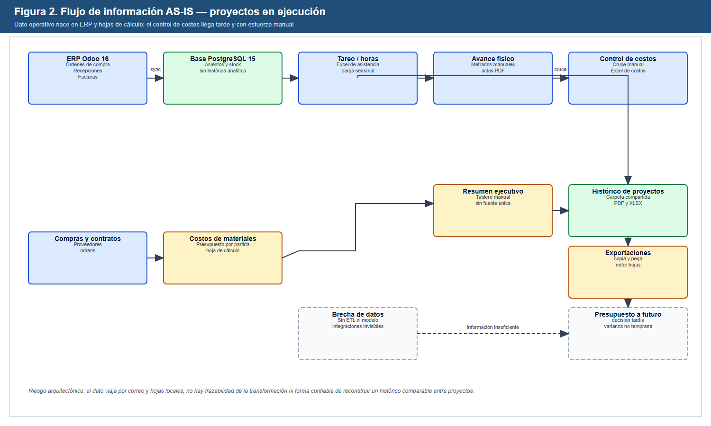
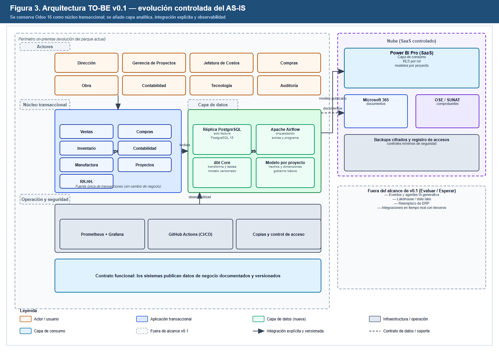
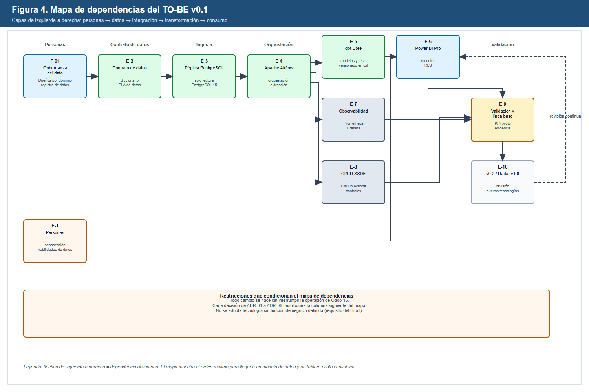

# Proyecto Integrador — Semana 5

## Hito I: arquitectura AS-IS / TO-BE v0.1

**Transformación Digital de Constructora Andina S.A.C.**
*Hacia el control integrado de costos previsto vs. ejecutado a partir de los históricos de obra*

Universidad Nacional Mayor de San Marcos (UNMSM) — FISI — Ingeniería de Software
Curso: Tendencias en Ingeniería de Software y Gestión — Proyecto Integrador 2026-2
Grupo 1 · Docente: Mg. PMP Yamil Quiñones Nieto

---

### Control de versiones

| Versión | Fecha | Cambio principal | Responsable |
|---|---|---|---|
| v1.0 | 09/10/2026 | Consolidación de las semanas 1–5: arquitectura AS-IS, deuda técnica priorizada, arquitectura TO-BE v0.1, seis decisiones arquitectónicas y mapa de dependencias | Equipo |

**Objetivo del Hito I (guía del curso):** consolidar en un solo documento la fotografía arquitectónica actual, los problemas que la limitan y una versión objetivo proporcional, con decisiones justificadas y un mapa de dependencias para implementarla.
**Peso en el proyecto:** 8 % (acumulado 25 %). **Regla del hito:** es una fotografía hasta la semana 5; toda corrección posterior debe registrarse y justificarse.

---

## 1. Resumen ejecutivo

Constructora Andina S.A.C. opera con un ERP Odoo 16 Enterprise on-premise que registra la transacción, pero **no reutiliza sus históricos** para presupuestar ni para controlar el costo previsto frente al ejecutado. La información de obra se completa en hojas de cálculo locales, se consolida por correo y tarda hasta 15 días en reflejar el estado económico real.

El Hito I no propone reemplazar el ERP. Propone una **evolución por capas**: mantener Odoo 16 como núcleo transaccional, agregar una capa de datos analítica (réplica de solo lectura, orquestación y transformación versionada), publicar un modelo gobernado y consumirlo con Power BI Pro bajo control de acceso. La arquitectura objetivo v0.1 excluye explícitamente eventos, agentes de IA, lakehouse y nuevas integraciones en tiempo real porque **no tienen todavía una función de negocio definida y evidenciada** en el caso.

La consolidación de las semanas 1–5 da como resultado seis decisiones arquitectónicas (ADR-01 a ADR-06), once problemas y deudas técnicas priorizadas (DT-01 a DT-11) y un mapa de dependencias con nueve habilitadores (E-1 a E-9) sobre una base de gobernanza (F-01).

---

## 2. Trazabilidad de la consolidación (semanas 1–5)

| Semana | Artefacto entregado | Aporte al Hito I |
|---|---|---|
| 1 | Caso, Project Charter, stakeholder map inicial y Technology Radar v0.1 | Define alcance, objetivos, 12 tendencias y los anillos Adoptar/Probar/Evaluar/Esperar que acotan el TO-BE |
| 2 | Business Model Canvas, oportunidades P-01 a P-03, decisiones D-01 a D-10 y supuestos SE-01 a SE-10 | Explica por qué el valor está en costos y datos, no en cambiar el negocio; fundamenta D-02 y D-07 |
| 3 | Stakeholder map ampliado, madurez sociotécnica (6 dimensiones), skills gap, 5 resistencias y plan de adopción | Identifica la brecha de personas y el riesgo de adopción que condiciona el orden de implementación |
| 4 | Problema, propuesta de valor, hipótesis H1–H3, PoC y Impact Canvas | Fija la métrica de valor y demuestra viabilidad técnica sin tocar el ERP en producción |
| 5 | AS-IS, deuda técnica, TO-BE v0.1, ADR y mapa de dependencias | Cierra el Hito I y convierte las hipótesis en una arquitectura implementable |

**Coherencia verificada:** el problema de la Semana 4 (histórico no reutilizado) es el mismo que ataca la oportunidad P-01 de la Semana 2 y la misma que la arquitectura TO-BE habilita. No se introduce ninguna tecnología que no tenga una función declarada en esa cadena.

---

## 3. Arquitectura AS-IS

### 3.1 Aplicaciones, datos, integraciones y límites

| Capa | Elementos observados | Límite o problema |
|---|---|---|
| Actores | Gerencia, Proyectos, Costos, Compras, Obra, Contabilidad, TI (2 FTE) y auditoría | La información económica se consulta por canales distintos y con versiones distintas |
| Aplicaciones | Odoo 16 Enterprise on-premise (Ventas, Compras, Inventario, Contabilidad, Manufactura, Proyectos, RR.HH.), Excel 2021/365 y SharePoint/Outlook | No existe plataforma analítica, catálogo de datos ni capa de integración |
| Datos | PostgreSQL 15 transaccional, archivos Excel y documentos PDF/Word | El histórico vive en el ERP, pero su explotación depende de extracciones manuales |
| Infraestructura | Dos servidores Hiper-V, NAS on-premise y copias locales | Capacidad y continuidad dependen de un equipo TI de dos personas |
| Sistemas externos | Hosting del proveedor, SUNAT y OSE certificado | Comprobantes y declaraciones se gestionan con intercambio manual o semi-manual |
| Integraciones | Exportaciones XLSX, correo y carga manual | No hay contrato de datos, trazabilidad de transformación ni reconciliación automática |

### 3.2 Flujo de información actual

El dato nace en el ERP y en las hojas de obra, pero el control de costos se reconstruye manualmente. El resultado es un histórico **no comparable entre proyectos**: cada analista aplica criterios propios y no queda registro de cómo se transformó la cifra. Esta es la causa raíz que la Semana 4 formuló como hipótesis H1 y que la Semana 2 identificó como P-01.

---

## 4. Problemas arquitectónicos y deuda técnica priorizada

Prioridad calculada como **impacto en el negocio × urgencia**, ajustada por el riesgo asociado. La columna "Origen" mantiene la trazabilidad con las semanas previas.

| ID | Problema / deuda técnica | Evidencia | Impacto | Prioridad | Origen |
|---|---|---|---|---|---|
| DT-01 | Ausencia de una fuente única para el histórico de costos y rendimientos | Excel locales; P-01; H1 | Alto | **P1** | S2, S4 |
| DT-02 | Sin contrato de datos ni diccionario de definiciones | Cifras dispares entre áreas; D-03 | Alto | **P1** | S2, S3 |
| DT-03 | Extracción manual y no reproducible desde el ERP | Exportaciones XLSX; R-01 | Alto | **P1** | S1, S4 |
| DT-04 | Modelo de datos inexistente para previsto vs. ejecutado | Consolidación tardía (hasta 15 días) | Alto | **P1** | S3, S4 |
| DT-05 | Consultas de reporte sobre la misma base transaccional | Riesgo de degradar Odoo; R-03 | Medio | **P2** | S1 |
| DT-06 | Sin control de versiones de transformaciones ni de indicadores | No hay linaje; SE-07 | Medio | **P2** | S2, S4 |
| DT-07 | Sin observabilidad de procesos de datos | Fallos detectados por el usuario | Medio | **P2** | S1 |
| DT-08 | Despliegues y pruebas manuales en TI | Madurez DevEx nivel 2; R-07 | Medio | **P2** | S3 |
| DT-09 | Acceso a información económica sin RLS ni auditoría sistemática | R-04 | Alto | **P1** | S1, S2 |
| DT-10 | Dependencia de conocimiento individual en Costos | Resistencia a abandonar planillas | Medio | **P3** | S3 |
| DT-11 | Sin línea base de adopción y calidad de datos | H3; SE-07 | Medio | **P3** | S3, S4 |

**Regla de priorización:** ningún ítem P1 se resuelve comprando tecnología. DT-01, DT-02, DT-03, DT-04 y DT-09 se atacan con acuerdos, definiciones y automatización simple; la herramienta solo materializa la decisión.

---

## 5. Arquitectura TO-BE v0.1

### 5.1 Capacidades objetivo

| Capacidad | Componente | Función de negocio explícita | Estado |
|---|---|---|---|
| Transacción sin cambio de negocio | Odoo 16 Enterprise on-premise | Mantener ventas, compras, inventario, contabilidad, manufactura, proyectos y RR.HH. | Se conserva |
| Lectura analítica aislada | Réplica PostgreSQL 15 de solo lectura | Evitar que las consultas analíticas degraden la operación (R-03) | Nueva |
| Orquestación | Apache Airflow | Programar y reintentar extracciones de forma reproducible | Nueva |
| Transformación y calidad | dbt Core | Versionar modelos y pruebas de datos; generar linaje (R-01) | Nueva |
| Modelo de consumo | Modelo por proyecto (hechos y dimensiones) | Sostener previsto vs. ejecutado y ratios por partida (H1) | Nueva |
| Consumo | Power BI Pro (SaaS) con RLS | Publicar tableros con acceso por rol (R-04) | Nueva |
| Operación | Prometheus + Grafana | Detectar fallos de extracción y freshness del dato | Nueva |
| Entrega segura | GitHub Actions con prácticas SSDF | Automatizar pruebas y despliegue de la capa de datos (NIST SSDF) | Nueva |
| Contrato funcional | Datos publicados, documentados y versionados | Permitir que Costos, Obra y Gerencia usen la misma definición | Nueva |

### 5.2 Fuera del alcance de v0.1 (decisión explícita)

| Elemento | Anillo del Radar | Razón para no incluirlo |
|---|---|---|
| Agentes de IA con acciones sobre ERP o presupuesto | Esperar | Privilegios y decisiones económicas; requisito de supervisión humana |
| RAG sobre conocimiento de obra | Evaluar | No es requisito para resolver el problema principal de costos |
| Arquitectura orientada a eventos | Evaluar | No se ha demostrado necesidad de tiempo real |
| Lakehouse / data lake | Probar | La escala no justifica la complejidad; primero se valida la capa proporcional |
| Reemplazo del ERP | Descartado | D-02: el ERP es crítico y de baja sustituibilidad |
| SaaS del ERP para terceros | Descartado | D-07: implicaría cambiar de negocio |

**Criterio del Hito I:** cada componente del TO-BE tiene una función declarada y un riesgo asociado. Lo que no cumple ambas condiciones queda fuera, aunque sea tendencia.

---

## 6. Decisiones arquitectónicas (ADR)

Las seis decisiones se versionan en este documento. Cada una enlaza alternativas, trade-offs, evidencia y el riesgo que controla. El registro completo de decisiones del proyecto (D-01 a D-10) se mantiene en la sección 8.

### ADR-01 — Evolucionar el ERP en lugar de reemplazarlo

| Campo | Contenido |
|---|---|
| Decisión | Mantener Odoo 16 Enterprise on-premise como núcleo transaccional y construir capacidades alrededor de él |
| Alternativas | (a) Reemplazo por un ERP nuevo; (b) plataforma independiente que duplique la transacción; (c) evolución por capas |
| Trade-offs | Se acepta la dependencia del proveedor y del hosting actual a cambio de no interrumpir la operación ni migrar datos críticos; la evolución es más lenta pero reversible |
| Evidencia | D-02 (S2), análisis de dependencias críticas, madurez de TI nivel 2 (S3) |
| Riesgo | R-02 (sobredimensionar) y R-07 (capacidad del equipo); se controla con alcance acotado y capacitación |

### ADR-02 — Réplica de solo lectura antes que consultas directas al ERP

| Campo | Contenido |
|---|---|
| Decisión | Crear una réplica PostgreSQL 15 de solo lectura para la carga analítica |
| Alternativas | (a) Consultar la base transaccional; (b) copia lógica nocturna; (c) réplica de solo lectura |
| Trade-offs | Añade infraestructura y un proceso de replicación que hay que operar; evita el riesgo de degradar la operación y permite consultas pesadas |
| Evidencia | DT-05, R-03, patrón estándar de separación de cargas transaccional/analítica |
| Riesgo | R-03 y R-04; se controla con permisos de solo lectura y monitoreo de latencia |

### ADR-03 — Integración por lotes orquestados, no por eventos

| Campo | Contenido |
|---|---|
| Decisión | Usar extracción por lotes orquestada con Apache Airflow y transformación con dbt Core |
| Alternativas | (a) Arquitectura orientada a eventos; (b) ETL punto a punto; (c) lotes orquestados |
| Trade-offs | La actualización no es en tiempo real; se gana simplicidad, reintentos y trazabilidad compatibles con un equipo de dos personas |
| Evidencia | T8 en Evaluar; no existe requisito de tiempo real; D-04 (probar antes de seleccionar plataforma) |
| Riesgo | R-02; se revisa si aparece una necesidad operativa que exija eventos |

### ADR-04 — Transformación versionada y con pruebas de datos

| Campo | Contenido |
|---|---|
| Decisión | Modelar y transformar con dbt Core, con pruebas y control de versiones en Git |
| Alternativas | (a) SQL suelto en el orquestador; (b) transformación dentro de Power BI; (c) dbt Core |
| Trade-offs | Requiere disciplina de repositorio y curva de aprendizaje; a cambio se obtiene linaje, reproducibilidad y detección temprana de datos inconsistentes |
| Evidencia | DT-02, DT-06, R-01, NIST SSDF (entrega segura) |
| Riesgo | R-07 (habilidades); se controla con capacitación y un primer modelo acotado |

### ADR-05 — Consumo con Power BI Pro y seguridad por rol

| Campo | Contenido |
|---|---|
| Decisión | Publicar el modelo en Power BI Pro (SaaS) con RLS por rol y gobierno de accesos |
| Alternativas | (a) Tableros dentro del ERP; (b) solución open source autoalojada; (c) Power BI Pro |
| Trade-offs | Se asume un costo de suscripción recurrente y dependencia de un proveedor SaaS; se gana tiempo de implementación y control de acceso maduro |
| Evidencia | D-09 (API-first interno), DT-09, R-04, capacidad actual de Microsoft 365 |
| Riesgo | R-08 (costo variable) y R-04; se controla con licencias nominales y RLS |

### ADR-06 — Observabilidad y entrega segura desde el primer piloto

| Campo | Contenido |
|---|---|
| Decisión | Incorporar Prometheus/Grafana y GitHub Actions con controles SSDF en la capa de datos |
| Alternativas | (a) Operación manual; (b) monitoreo solo del ERP; (c) observabilidad y CI/CD desde el piloto |
| Trade-offs | Agrega esfuerzo inicial y herramientas que un equipo pequeño debe sostener; reduce el tiempo de detección de fallos y el riesgo de desplegar transformaciones sin pruebas |
| Evidencia | DT-07, DT-08, T9 en Adoptar, T10 en Probar |
| Riesgo | R-07 y R-02; se controla con alcance mínimo (métricas de freshness y fallo) |

**Resumen de trade-offs:** las seis decisiones priorizan reversibilidad, bajo acoplamiento y proporcionalidad sobre sofisticación. Ninguna adopta una tecnología por moda: cada una responde a un problema priorizado o a un riesgo del registro.

---

## 7. Mapa de dependencias para implementar el TO-BE

### 7.1 Habilitadores y orden mínimo

| ID | Habilitador | Depende de | Desbloquea | Responsable propuesto |
|---|---|---|---|---|
| F-01 | Gobernanza del dato (dueños por dominio y registro) | — | E-2, E-6 | Gerencia + TI |
| E-1 | Personas: capacitación y habilidades de datos | F-01 | E-6 | Líder de capacitación |
| E-2 | Contrato de datos (diccionario y SLA) | F-01 | E-3 | Dueños de dominio |
| E-3 | Réplica PostgreSQL de solo lectura | E-2 | E-4 | TI |
| E-4 | Apache Airflow (orquestación) | E-3 | E-5, E-7, E-8 | TI |
| E-5 | dbt Core (modelos y pruebas) | E-4 | E-6 | TI + Costos |
| E-6 | Power BI Pro (modelos y RLS) | E-5, E-1 | E-9 | TI + Gerencia |
| E-7 | Observabilidad (Prometheus/Grafana) | E-4 | E-9 | TI |
| E-8 | CI/CD con prácticas SSDF (GitHub Actions) | E-4 | E-9 | TI |
| E-9 | Validación y línea base del piloto | E-6, E-7, E-8 | E-10 | Costos + Gerencia |
| E-10 | Revisión v0.2 y Radar v1.0 | E-9 | Siguiente ciclo | Equipo |

### 7.2 Ruta crítica y restricciones

1. **Ruta crítica:** F-01 → E-2 → E-3 → E-4 → E-5 → E-6 → E-9. Sin contrato de datos no hay réplica confiable; sin réplica no hay orquestación; sin transformación no hay tablero defendible.
2. **Paralelizable:** E-1 (personas), E-7 (observabilidad) y E-8 (CI/CD) pueden avanzar en paralelo con E-4, pero no reemplazan la ruta crítica.
3. **Restricción operativa:** ningún cambio puede interrumpir la operación de Odoo 16.
4. **Restricción de alcance:** cada ADR desbloquea una columna del mapa; no se avanza a la siguiente sin evidencia de la anterior.
5. **Restricción de proporcionalidad:** si E-9 no demuestra valor con el piloto, no se escala a v0.2 (D-04).

---

## 8. Registro de decisiones consolidado (D-01 a D-10)

| ID | Decisión | Estado en el Hito I | Relación con ADR |
|---|---|---|---|
| D-01 | Enfocar el caso en el uso histórico de costos y rendimientos | Vigente | ADR-04 |
| D-02 | Evolucionar el ERP sin reemplazarlo | Vigente (reforzada) | ADR-01 |
| D-03 | Priorizar calidad de datos y BI antes de IA avanzada | Vigente | ADR-04 |
| D-04 | Probar una arquitectura analítica proporcional antes de elegir plataforma | Vigente | ADR-02, ADR-03 |
| D-05 | Mantener agentes con acciones sobre presupuesto o ERP en Esperar | Vigente (reforzada) | Fuera de alcance v0.1 |
| D-06 | Business Model Canvas como representación oficial del AS-IS | Inicial | Contexto del AS-IS |
| D-07 | No priorizar la provisión del ERP o su capa analítica como SaaS a terceros | Inicial | Fuera de alcance v0.1 |
| D-08 | Portal de cliente acotado como componente potencial de valor | Inicial | No incluido en v0.1 |
| D-09 | Enfoque API-first interno antes de exponer APIs a terceros | Inicial | ADR-03, ADR-05 |
| D-10 | E-commerce limitado a captación, reserva y pago digital | Inicial | No aplica a v0.1 |
| D-11 | Fijar BI y analítica operacional como tendencia principal de trabajo | Vigente | ADR-04, ADR-05 |
| D-12 | Validar H1 con un PoC de estimación por históricos sobre datos sintéticos | Vigente | E-9 |
| D-13 | Mantener la IA generativa en *Probar/Evaluar*, subordinada a H1 y H2 | Vigente | Fuera de alcance v0.1 |

**Nota de reconciliación (corrección registrada en el Hito I):** la Semana 4 volvió a usar los identificadores D-06, D-07 y D-08 para tres decisiones nuevas, que ya estaban asignados en la Semana 2. Para preservar la trazabilidad y no alterar el documento histórico de la Semana 4, en este Hito I esas tres decisiones se renumeran como **D-11, D-12 y D-13**. La corrección queda versionada aquí y no modifica el contenido de la entrega anterior.

**Supuestos que condicionan el Hito I:** SE-03 (costo de TI fijo), SE-04 (costos de no calidad no registrados), SE-07 (beneficios medidos en horas y discrepancias), SE-09 (integración viable solo con proveedores recurrentes) y SE-10 (consumo cloud como costo variable con seguimiento).

---

## 9. Riesgos, hipótesis y trazabilidad de valor

| Riesgo | Cómo lo controla el TO-BE v0.1 | Hipótesis / evidencia |
|---|---|---|
| R-01 Históricos incompletos | Contrato de datos (E-2) y pruebas dbt (E-5) | H1; DT-01, DT-02 |
| R-02 Plataforma sobredimensionada | Alcance v0.1 acotado y validación E-9 antes de escalar | D-04; DT-04 |
| R-03 Consultas afectan al ERP | Réplica de solo lectura (E-3) | DT-05 |
| R-04 Acceso indebido | RLS en Power BI y mínimo privilegio | DT-09 |
| R-05 / R-06 IA incorrecta o insegura | Agentes y RAG fuera del alcance v0.1 | T5–T7; D-05 |
| R-07 Falta de capacidades | Plan de adopción S3 y E-1 | Madurez nivel 2; skills gap |
| R-08 Costos variables | Licencias nominales y FinOps solo si aparece consumo material | SE-10 |
| R-09 Datos reales en PoC | Datos sintéticos, sin datos confidenciales | PoC S4 |
| R-10 Indicadores no aceptados | Contrato de datos y co-diseño con Costos y Obra | S3; H3 |

**Trazabilidad de valor:** H1 (reducir el error de estimación a ±15 %) se sostiene con E-2, E-3, E-4 y E-5. H2 (viabilidad sin tocar producción) se sostiene con E-3 y E-4. H3 (adopción ≥70 % semanal) se sostiene con E-1, E-6 y el plan de adopción de la Semana 3.

---

## 10. Contribuciones del equipo

| Integrante | Actividad en el Hito I | Artefacto | Fecha | Evidencia |
|---|---|---|---|---|
| Anthony Romani | Consolidación de stakeholders y del AS-IS de actores e integraciones | Sección 3 | 09/10/2026 | Documento: Sección 3; Figura 1 |
| Max Astuhuaman | Deuda técnica priorizada y decisiones arquitectónicas ADR-01 a ADR-06 | Secciones 4 y 6 | 09/10/2026 | Documento: Secciones 4 y 6 |
| Guillermo Calle | Arquitectura TO-BE v0.1, diagramas y mapa de dependencias | Secciones 5 y 7 | 09/10/2026 | Figuras 1–4; `arquitectura/` |
| Pablo Mendoza | Trazabilidad semanas 1–5, riesgos, revisión de coherencia y consolidación final | Secciones 2 y 9 | 09/10/2026 | Documento: Secciones 2 y 9; revisión final |

*(El registro editable se mantiene en `gestion/registros/` con autor, actividad, fecha y evidencia verificable. No se fabrican nombres, commits ni enlaces.)*

---

## 11. Referencias

AACE International. (2020). *Recommended Practice No. 18R-97: Cost Estimate Classification System – As Applied in Engineering, Procurement, and Construction for the Process Industries* (Rev. August 7, 2020). AACE International. https://web.aacei.org/docs/default-source/toc/toc_18r-97.pdf

DORA. (2025). *State of AI-assisted Software Development 2025*. https://dora.dev/research/2025/dora-report/

International Organization for Standardization. (2011). *Systems and software engineering — Architecture description* (ISO/IEC/IEEE 42010:2011). ISO.

Kruchten, P., Nord, R. L., & Ozkaya, I. (2012). Technical debt: From metaphor to theory and practice. *IEEE Software, 29*(6), 18–21. https://doi.org/10.1109/MS.2012.167

National Institute of Standards and Technology. (2025). *Secure Software Development Framework (SSDF) Version 1.2* (NIST SP 800-218 Rev. 1). https://csrc.nist.gov/

Osterwalder, A., Pigneur, Y., Bernarda, G., & Smith, A. (2014). *Value Proposition Design*. Wiley.

Thoughtworks. (2025). *Technology Radar, Volume 33*. https://www.thoughtworks.com/radar

---

## 12. Cierre del Hito I y siguiente paso

El Hito I queda cerrado con una fotografía coherente: el AS-IS explica el problema, la deuda técnica lo prioriza, el TO-BE v0.1 lo ataca con el mínimo de componentes y los ADR justifican cada apuesta. La implementación no comienza por la herramienta más visible, sino por el contrato de datos y la réplica de lectura, que son la base de todo lo demás.

**Siguiente paso (Semana 6):** revisar el Hito I con el docente, registrar las correcciones como versiones del registro de decisiones y actualizar el Radar a v1.0 con la evidencia del piloto. No se ampliará el alcance del TO-BE hasta que E-9 demuestre valor con datos medidos.

---

*Documento elaborado por el Grupo 1. Los diagramas son representaciones de arquitectura, no despliegues reales. Las cifras de desempeño citadas provienen de las fuentes indicadas o de la línea base declarada en la Semana 4; no se presentan resultados de negocio no medidos.*
