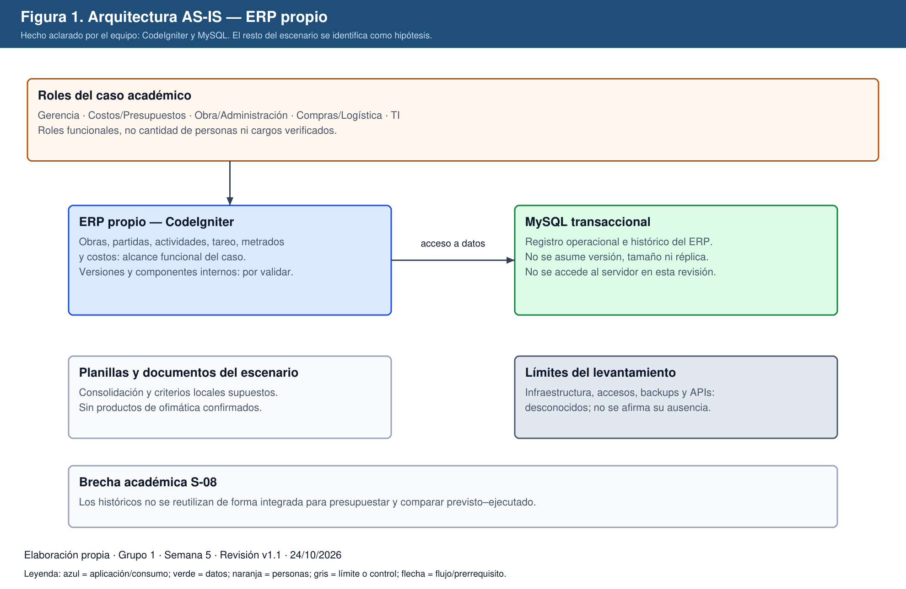
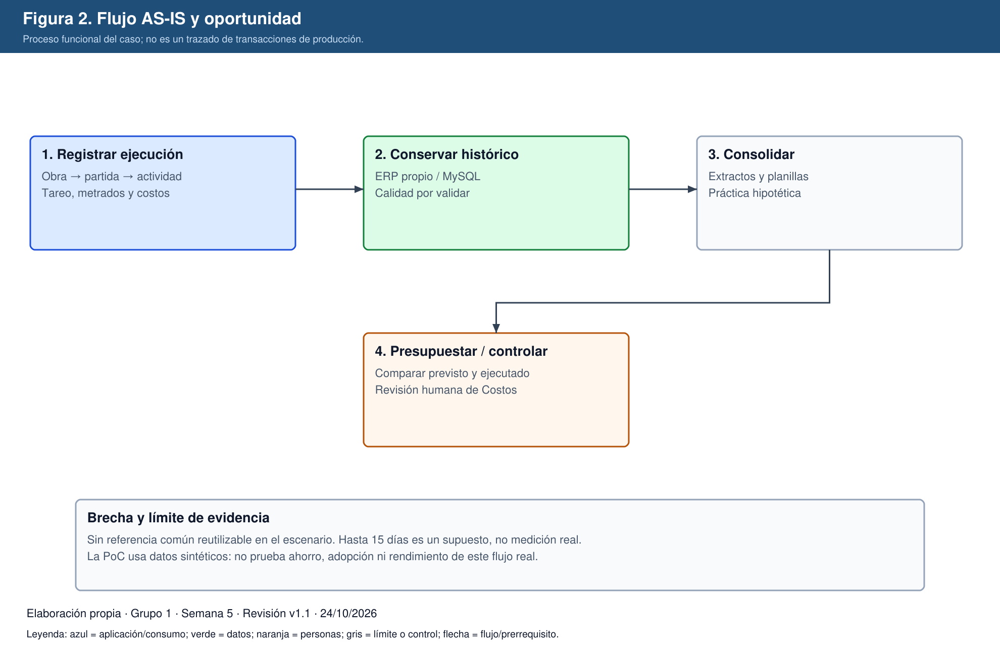
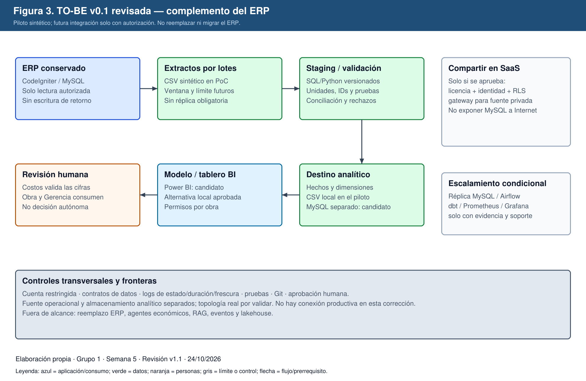
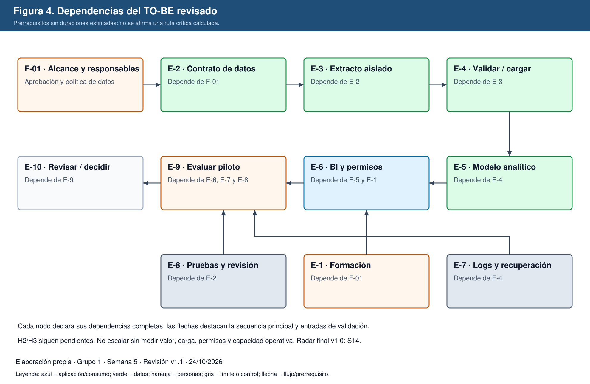

# Proyecto Integrador — Hito I corregido

## Estrategia de adopción tecnológica 2026–2029

**Constructora Andina S.A.C. — Grupo 1 — Semana 5**

Universidad Nacional Mayor de San Marcos — FISI — Ingeniería de Software.
Curso: Tendencias en Ingeniería de Software y Gestión. Docente: Mg. PMP Yamil Quiñones Nieto.
Integrantes: Anthony Romani, Max Astuhuaman, Guillermo Calle y Pablo Mendoza.
Versión documental: **v1.1**. Fecha de corrección: **24/10/2026**. Arquitectura objetivo: **TO-BE v0.1 revisada**.
Peso de la semana 5: 8 %; acumulado curricular hasta semana 5: 25 %. No es una calificación obtenida.

## 1. Control de cambios y alcance de la corrección

El caso es académico y ficticio, inspirado en un proceso funcional anonimizado. El equipo confirmó durante esta revisión que el ERP de referencia es propio y está desarrollado en CodeIgniter y MySQL. Esta confirmación no revela versiones, esquema, servidores, datos ni configuraciones internas.

Se conserva el ERP: no se propone reemplazarlo, migrarlo a otro producto ni reescribirlo. Las versiones históricas de semanas 1–5 se mantienen intactas. Este documento las integra y corrige; no acredita una entrega retroactiva ni modifica automáticamente una nota previa. Los registros y anexos v1.1 forman parte de esta versión.

| Cambio | Situación anterior | Corrección y motivo |
|---|---|---|
| C-01 | Odoo 16 / PostgreSQL 15 presentados como AS-IS | ERP propio CodeIgniter / MySQL, según aclaración del equipo; versiones no confirmadas |
| C-02 | Dos personas TI, dos servidores, Hyper-V, NAS y Microsoft 365 como hechos | Se retiran esas afirmaciones: no existe confirmación de inventario o dotación |
| C-03 | Entrevistas, quejas y observaciones de madurez presentadas como evidencia | Diagnóstico hipotético del escenario académico; no se afirman entrevistas realizadas |
| C-04 | IDs D-06–D-08 repetidos entre semanas 2 y 4 | Se preservan D-06–D-10 de S2; S4 se identifica como D-11–D-13 |
| C-05 | Airflow, dbt, réplica y stack de monitoreo seleccionados sin dimensionamiento | TO-BE mínimo por lotes; productos especializados condicionados a evidencia |
| C-06 | MAPE promedio tratado como límite por partida; H2 y H3 implícitamente demostradas | H1 descriptiva y sintética; H2 y H3 pendientes; reglas de decisión uniformes |
| C-07 | Excel S5 con solo registros de S1 | Libro v1.1 regenerado desde tablas de este documento y registro histórico de S1 |
| C-08 | Semana 6 descrita como cierre de arquitectura y Radar final | S6 corresponde a AI-Native SDLC; Radar v1.0 final en S14 |

La revisión corrige interpretación y coherencia. No se inventan resultados, precios, entrevistas, firmas ni contribuciones individuales. Los datos de negocio distintos de la aclaración tecnológica son supuestos o características del caso, no hallazgos de una auditoría empresarial.

## 2. Consolidación de semana 1: caso, alcance y Charter

### 2.1 Ficha y stakeholders

Constructora Andina S.A.C. es una inmobiliaria-constructora peruana ficticia de tamaño mediano. Usuarios principales: Gerencia, Obra, Costos/Presupuestos, Administración, Compras/Logística y TI. Atiende contratantes y compradores inmobiliarios; las operaciones públicas solo se consideran si el contrato las requiere. El ERP registra obras, partidas, actividades, tareo, metrados, compras y costos. La normativa de edificación, seguridad laboral y protección de datos delimita el contexto descrito en S1; su aplicabilidad concreta requiere validar el contrato y el tratamiento de datos.

### 2.2 Project Charter consolidado

**Problema:** los históricos de costos, horas y metrados no se reutilizan de manera integrada para presupuestar nuevas obras ni comparar sistemáticamente lo previsto con lo ejecutado.

**Oportunidad:** transformar registros existentes en referencias trazables de rendimiento y costo, sin reemplazar el ERP y antes de automatizar decisiones económicas con IA.

**Objetivo general:** diseñar una estrategia de adopción tecnológica 2026–2029 para mejorar planificación, presupuestación y control económico mediante información operacional confiable.

**Objetivos específicos:** (1) caracterizar procesos y brechas; (2) evaluar integración, datos, analítica, IA e ingeniería segura; (3) diseñar una arquitectura proporcional; (4) experimentar sobre incertidumbres; (5) definir una secuencia con valor, responsables, riesgos y criterios de continuidad.

**Alcance:** información de obras, partidas, actividades, tareo, metrados, costos, referencias históricas, presupuesto, analítica y controles relacionados. **Fuera de alcance:** reemplazar el ERP, intervenir producción, modificar planillas laborales o automatizar decisiones económicas sin aprobación humana.

**Restricciones:** entorno académico, datos sintéticos o anonimizados autorizados, capacidades e infraestructura pendientes de validar, ausencia de presupuestos financieros reales. **Éxito preliminar:** trazabilidad origen–indicador, decisiones justificadas, experimentos reproducibles y arquitectura explicable. No se atribuyen porcentajes de ahorro reales.

La sección de Charter se mantiene breve; el documento histórico S1 contiene el Charter original de una página. Referencias internas históricas a S-08 deben entenderse como la brecha de la sección 3.1 de ese informe, no una inexistente sección 3.3. La versión vacía de su portada se conserva como defecto histórico, no se le asigna retrospectivamente una versión confirmada.

### 2.3 Radar e Impact Canvas

Se conserva el Radar v0.1 de S1, editable y exportado en `radar/`. Anillos: Adoptar = incorporar progresivamente la capacidad; Probar = experimentar; Evaluar = investigar pertinencia; Esperar = postergar. No equivalen a productos comprados ni a sistemas ya implantados.

| ID | Tendencia | Cuadrante | Anillo | Justificación vigente |
|---|---|---|---|---|
| T1 | APIs e integración | Integración y arquitectura | Adoptar | Contratos de integración cuando exista consumidor; no exige API nueva para el piloto por lotes |
| T2 | BI y analítica operacional | Datos y analítica | Adoptar | Comparar previsto y ejecutado con definiciones comunes |
| T3 | Gobierno y calidad de datos | Datos y analítica | Adoptar | Validar referencias históricas antes de decidir |
| T4 | Arquitectura analítica | Datos y analítica | Probar | Probar separación de cargas y modelo acotado |
| T5 | IA generativa operacional | IA y automatización | Probar | Solo experimentos con datos autorizados y revisión humana |
| T6 | RAG | IA y automatización | Evaluar | No hay necesidad documental demostrada |
| T7 | Agentes de IA | IA y automatización | Esperar | No delegar acciones económicas ni escritura al ERP |
| T8 | Eventos | Integración y arquitectura | Evaluar | No hay requisito probado de tiempo real |
| T9 | DevSecOps / SSDF | Ingeniería y operación | Adoptar | Pruebas, revisión y secretos fuera del repositorio |
| T10 | Observabilidad | Ingeniería y operación | Probar | Primero registros de ejecución y frescura del dato |
| T11 | Platform Engineering / IDP | Ingeniería y operación | Esperar | Fricción y escala no dimensionadas |
| T12 | FinOps / AI FinOps | Ingeniería y operación | Evaluar | Aplicar al aparecer consumo variable material |

No hay cambio de anillo en esta corrección. T5 permanece en Probar, no en el anillo ambiguo «Probar/Evaluar». Las justificaciones son decisiones del equipo, no ubicaciones supuestamente prescritas por un radar externo.

| Tendencia | Valor | Arquitectura | Personas | Seguridad | Economía | Sostenibilidad |
|---|---|---|---|---|---|---|
| BI operacional | Control previsto–ejecutado y referencias de presupuesto | Modelo acotado separado del ERP | Costos valida definiciones; Obra interpreta desvíos | Permisos por obra, aprobación y trazabilidad | Licencias y esfuerzo frente a horas evitadas, aún no medidas | Reusar históricos y limitar refrescos |
| Arquitectura analítica | Histórico comparable y reutilizable | Extracto, staging, transformaciones y modelo dimensional | TI y responsable de datos requieren formación | Mínimo privilegio, conciliación y retención acordada | Medir operación antes de escalar | Evitar duplicados y retención indefinida |
| IA generativa | Posibles consultas o explicaciones asistidas | Acceso acotado solo a datos autorizados | Aceptación o rechazo humano | Riesgo de fuga, alucinación y prompt injection | No consumir IA sin evaluación de costo/utilidad | Preferir BI o reglas simples si bastan |

El registro histórico conserva fuentes citadas en S1; las no verificadas de nuevo quedan explícitamente pendientes de comprobación. Las decisiones corregidas se sustentan en las fuentes específicas de la sección 12.

## 3. Consolidación de semana 2: modelo de negocio

| Bloque BMC AS-IS | Contenido del escenario |
|---|---|
| Socios | Proveedores, subcontratistas, proyectistas, banca y soporte tecnológico |
| Actividades | Presupuestar, ejecutar, tarear, medir, comprar, valorizar y atender posventa |
| Propuesta de valor | Obra entregada según alcance, plazo, calidad y obligaciones contractuales |
| Relación con clientes | Contrato, reuniones de avance, valorizaciones y posventa |
| Segmentos | Contratantes privados y compradores; públicos solo cuando corresponda |
| Recursos | Personal, equipos, capital, ERP propio e históricos; dotación no confirmada |
| Canales | Comercial y canales digitales hipotéticos de captación; correo y ERP interno |
| Costos | Mano de obra, materiales, subcontratos, equipos, administración y TI |
| Ingresos | Contratos valorizados, venta de unidades y adicionales reconocidos; sin SaaS propio |

El BMC es editable en este documento y en el libro v1.1. No se asume que la empresa ya utiliza Microsoft 365 o un portal específico. Los nombres de hojas `Canvas_Data` citados en S2 se materializan ahora como anexos reconstruidos del contenido documental, no como archivos entregados en aquella fecha.

| Propuesta | Cambio y efecto económico | Beneficio esperado | Riesgo principal | Validación |
|---|---|---|---|---|
| P-01 | Referencias históricas gobernadas; eficiencia y costo, no nuevos ingresos | Mejorar presupuesto y detectar desvíos | Histórico inconsistente | Comparación sintética S4 y posterior validación autorizada |
| P-02 | Portal acotado de cliente; valor percibido y potencial diferenciación | Menos consultas y mayor transparencia | Publicar datos erróneos o confidenciales | Piloto futuro informativo; no incluido en TO-BE v0.1 |
| P-03 | Integración de abastecimiento; eficiencia interna | Reducir redigitación y discrepancias | Dependencia de terceros | Diagnóstico de proveedores; no requiere eventos ahora |

SaaS se evalúa como consumo de servicios, no como comercialización del ERP. Plataforma se acota a participantes de obra, sin asumir efectos de red. API economy se orienta a integración interna y no a monetización. e-Business aplica a compras y documentación; e-Commerce se limita potencialmente a captación, reserva y pago, no al cierre íntegro de una obra en línea. Estas opciones son propuestas, no servicios existentes verificados.

| ID | Supuesto económico | Estado / validación |
|---|---|---|
| SE-01 | Ingresos por obra y unidades, no servicios digitales recurrentes | Escenario académico; contrastar con composición de ingresos |
| SE-02 | Mano de obra, materiales y subcontratos dominan el control | Por validar con estructura de costos |
| SE-03 | TI tiene componente fijo en el corto plazo | No presupone licencia ERP comercial; validar soporte, personal e infraestructura |
| SE-04 | Hay reprocesos no registrados como costo separado | Por validar mediante registro de incidencias |
| SE-05 | Transparencia podría ayudar a adjudicación o recompra | Hipótesis, no ingreso garantizado |
| SE-06 | Un portal añade desarrollo y operación | Estimar antes de piloto |
| SE-07 | Medir primero horas y discrepancias, sin monetización inventada | Definir línea base y método |
| SE-08 | No se asumen comisiones ni publicidad propias | Supuesto de alcance |
| SE-09 | Integración con algunos proveedores puede ser viable | Evaluar capacidad y autorización |
| SE-10 | Nube e IA pueden añadir gasto variable | Verificar precios y límites antes de contratar |

## 4. Consolidación de semana 3: diagnóstico hipotético y cambio

**Naturaleza:** todas las puntuaciones, resistencias, actitudes y plazos de esta sección son hipótesis del escenario académico. No se realizaron ni se acreditan entrevistas, encuestas o inspecciones empresariales en esta revisión. La fuente del diagnóstico es la coherencia del caso S1–S3; DORA (2025) orienta qué capacidades observar, pero no demuestra la madurez de esta empresa ficticia.

| Stakeholder | Influencia | Interés | Impacto | Estrategia | Base y validación futura |
|---|---|---|---|---|---|
| Gerencia | Alta | Alto | Alto | Co-diseñar indicadores y aprobar continuidad | Supuesto; validar prioridades |
| Costos / Presupuestos | Alta | Alto | Muy alto | Definir partidas, ratios y criterios de aceptación | Supuesto; revisar flujos con usuarios autorizados |
| Obra / Administración | Alta | Medio-alto | Alto | Registro simple y devolución útil de indicadores | Supuesto; prueba de usabilidad futura |
| Compras / Logística | Alta | Alto | Alto | Homologar catálogo y reconciliar costos | Supuesto; revisar duplicados sintéticos |
| TI | Alta | Alto | Alto | Diseñar piloto mantenible y revisar accesos | Stack confirmado; dotación y skills por validar |
| Seguridad / administración TI | Alta | Alto | Alto | Aprobar permisos, retención y auditoría | Rol propuesto, no puesto existente confirmado |
| Clientes | Media | Alto | Alto | Informar sin exponer costos internos | Supuesto; no publicar datos en este piloto |
| Personal de campo | Baja-media | Medio | Medio | Explicar finalidad y evitar vigilancia indebida | Supuesto; no cambiar jornada ni planilla |

Escala propuesta: 1 inicial; 2 en desarrollo; 3 definido; 4 gestionado; 5 optimizado. Los niveles no provienen de una medición real.

| Dimensión | Actual hipotético | Objetivo propuesto | Sustento del escenario | Acción y evidencia futura |
|---|---|---|---|---|
| Cultura | 2 | 3 | Uso paralelo de criterios locales supuesto | Co-diseño; registrar acuerdos |
| Colaboración / equipos virtuales | 2 | 3 | Transferencias manuales y sedes dispersas supuestas | Diccionario común y canal asíncrono; medir handoffs |
| DevEx | 2 | 3 | Automatización limitada supuesta | Pruebas y guion reproducible; medir fricción |
| Habilidades | 2 | 3 | Brecha analítica no medida | Evaluación de skills y formación acotada |
| Postura ante IA | 1 | 3 | Ausencia de política supuesta, no uso informal observado | Política de datos y revisión humana |
| Capacidad de cambio | 1 | 3 | Adopción no medida | Piloto con feedback y criterio de abandono |
| Datos | 2 | 3 | Histórico no integrado; S-08 | Calidad, catálogo y conciliación; medir completitud |
| Seguridad | 2 | 3 | Controles actuales desconocidos | Inventario de accesos y matriz; no afirmar ausencia real |

| Rol actual del escenario | Capacidad objetivo | Brecha hipotética | Acción | Responsable propuesto | Horizonte organizacional |
|---|---|---|---|---|---|
| Analista de presupuestos | Análisis de costos basado en datos | Planilla local a modelo común | Formación en ratios, BI y calidad | Costos | Q1 2027, por validar |
| Compras | Gestión de catálogo | Codificación dispersa | Homologación de insumos | Logística | Q1 2027, por validar |
| Desarrollo ERP | Integración y pruebas | Extracciones no versionadas | SQL, extracción segura y pruebas | TI | Q1–Q2 2027, por validar |
| Administración TI | Operación y accesos | Controles no inventariados | Mínimo privilegio y recuperación | TI / seguridad | Q1–Q2 2027, por validar |
| Jefatura de obra | Interpretación de desvíos | Uso de datos no medido | Taller de lectura de indicadores | Operaciones | Q2 2027, por validar |
| Responsable de datos propuesto | Custodia de definiciones | Rol no formalizado en el escenario | Asignar función, no crear puesto por defecto | Gerencia | Antes del piloto |

Cinco resistencias hipotéticas: registro percibido como carga; dependencia de planillas; temor a complejidad técnica; oposición a homologar códigos; distancia entre obra y sede. Se mitigan con captura simple, marcha en paralelo limitada, herramientas mínimas, acuerdos de catálogo y tableros de devolución. No se afirma que hayan ocurrido.

Plan organizacional propuesto: Q4 2026, acordar responsables y alcance; Q1 2027, formación y preparación de datos; Q2 2027, piloto y marcha en paralelo; después del piloto, evaluar adopción y decidir continuidad. Son horizontes del roadmap académico, no actividades realizadas. Las semanas del curso organizan los entregables, no despliegues empresariales obligatorios; semana 8 no genera trabajo evaluable y semana 15 es defensa.

## 5. Consolidación de semana 4: valor, hipótesis y experimento

### 5.1 Propuesta de valor

Usuario principal: Costos/Presupuestos; usuarios secundarios: Obra y Gerencia. Tareas: presupuestar, valorizar y explicar desvíos. Dolores hipotéticos: referencias dispersas, diferencias entre cifras y consolidación tardía. Ganancias esperadas: ratios comparables, trazabilidad y visibilidad oportuna. Aliviadores: modelo común, pruebas de calidad y referencia por partida; creadores de ganancia: estimación asistida por históricos y comparación previsto–ejecutado. Es un lienzo equivalente editable, no una validación de encaje con usuarios reales.

| ID | Hipótesis corregida | Experimento | Métrica y umbral | Decisión y estado |
|---|---|---|---|---|
| H1 | En el escenario sintético, estimar con ratios históricos mejora el promedio del error frente al control simulado | Seis obras cerradas y una nueva; seis partidas de evaluación | MAPE analítico ≤15 % y reducción relativa ≥30 % | Continuar si ambos; detener si MAPE >30 %; modificar en cualquier otro caso. Resultado descriptivo sintético favorable |
| H2 | Es viable construir extracción, modelo y tablero aislados de producción en ≤4 semanas de esfuerzo | Pipeline completo y registro de esfuerzo futuro | Reproducción del flujo completo sin acceso productivo; plazo supuesto | Pendiente: el código S4 no contiene tablero ni prueba de carga ERP |
| H3 | El piloto podría alcanzar ≥70 % de uso semanal y reducir ≥80 % el tiempo de valorización tras 4 semanas | Piloto con participantes humanos autorizados y línea base; no usuarios sintéticos | Usuarios activos / habilitados; tiempo total antes y después | Pendiente; modificar si falla un umbral; detener expansión si no reduce tiempo o hay daño |

MAPE = promedio de 100 × abs(estimado − real) / abs(real). Solo se define para costos reales distintos de cero. Un promedio ≤15 % no implica que cada partida esté dentro de ±15 % y no es un intervalo de confianza. La reducción = 100 × (MAPE control − MAPE analítico) / MAPE control; si el control es cero, no se computa reducción relativa.

Los umbrales 15 %, 30 %, 70 %, 80 %, cuatro semanas y los 15 días de consolidación son supuestos/metas internas del escenario, no benchmarks empresariales medidos. AACE 18R-97 trata clasificación de estimaciones en industrias de procesos: no demuestra un umbral MAPE por partida para esta constructora. La revisión no usa esa equivalencia ni el porcentaje sectorial 30–40 % sin verificar. No se ajustan umbrales después de mirar resultados para forzar aceptación.

### 5.2 Resultado reproducible y límites

El experimento utiliza `poc/POC-01-estimacion-historicos/`, semilla 20261002. Históricos, costos y metrados son sintéticos. El método estima costo/unidad; genera tareo como dato auxiliar, pero no calcula ni valida HH/unidad. El control se simula con ruido gaussiano de sigma 0,25 aplicado al costo real conocido: no representa un presupuesto humano observado y no es un método desplegable.

| Métrica del escenario fijo | Resultado histórico reproducible |
|---|---|
| MAPE control simulado | 20,19 % |
| MAPE analítico | 11,31 % |
| Reducción relativa | 43,98 % usando precisión interna |
| Error individual de CIM-01 | 15,87 %, supera 15 % |
| Error individual de INS-02 | 15,10 %, supera 15 % |
| Inferencia permitida | El guion funciona y satisface los umbrales descriptivos en este escenario |
| Inferencia no permitida | Ahorro real, superioridad estadística, adopción humana o viabilidad de toda la arquitectura |

No se ha ejecutado prueba de significancia ni validación sobre múltiples escenarios independientes. La semilla fija permite reproducción, no generalización. Próxima validación: variar dificultad y ruido, separar entrenamiento/evaluación, comparar con una línea base independiente y obtener revisión humana autorizada. No se simulan entrevistas ni adopción para llenar esas brechas.

Se mantienen las seis dimensiones del Impact Canvas de BI de la sección 2.3; el valor ahora se liga a H1, personas a H3 y la arquitectura a H2. El beneficio permanece condicionado al experimento y a la calidad de datos.

## 6. Arquitectura AS-IS corregida

| Capa | Conocido o confirmado | No confirmado / supuesto |
|---|---|---|
| Aplicación | ERP propio desarrollado en CodeIgniter | Versión de framework/PHP, topología y componentes internos |
| Base transaccional | MySQL | Versión, motor, volumen, índices, réplicas y rendimiento |
| Proceso del caso | Obras, partidas, actividades, tareo, metrados y costos | Completitud y calidad del histórico |
| Actores | Roles funcionales del escenario | Número de personas y dedicación real |
| Integración | No se requiere una API nueva para probar con CSV | APIs, OSE, SUNAT y contratos técnicos reales no inventariados |
| Infraestructura | No se revela ni necesita acceso para la PoC | Hosting local/nube, servidores, NAS, SO y respaldos |

El histórico está en el ERP del caso; el escenario supone consolidación mediante exportaciones y planillas. La base transaccional MySQL no se reemplaza. No se afirma que carezca de seguridad, respaldo u observabilidad: esos controles están por levantar.

## 7. Deuda técnica y priorización

Priorización cualitativa propuesta, no un cálculo numérico medido. P1 = condición previa de confiabilidad o confidencialidad; P2 = operación/repetibilidad a resolver en el piloto; P3 = optimización posterior. Impacto y urgencia deben revisarse con responsables antes de implementar. El riesgo es posible, no un incidente ocurrido.

| ID | Problema del escenario | Prioridad | Base / riesgo | ADR | Componente |
|---|---|---|---|---|---|
| DT-01 | Referencias históricas no comparables | P1 | S-08 / R-01 | ADR-04 | Modelo dimensional |
| DT-02 | Definiciones de datos no acordadas | P1 | Supuesto S3 / R-10 | ADR-04 | Diccionario y contrato |
| DT-03 | Extractos no reproducibles | P2 | Supuesto S4 / R-01 | ADR-02 | Extractor por lotes |
| DT-04 | Comparación previsto–ejecutado dispersa | P1 | P-01 / H1 | ADR-04 | Hechos y dimensiones |
| DT-05 | Posible carga analítica sobre producción | P1 | Riesgo no medido R-03 | ADR-02 | Extracción acotada y almacenamiento separado |
| DT-06 | Transformaciones sin versionado supuesto | P2 | SE-07 / R-01 | ADR-03 | SQL/Python en Git |
| DT-07 | Detección tardía de errores de carga | P2 | Hipótesis R-03 | ADR-06 | Registro de ejecución y alertas |
| DT-08 | Pruebas y despliegues manuales supuestos | P2 | Diagnóstico hipotético S3 | ADR-06 | Pruebas y revisión humana |
| DT-09 | Accesos económicos no inventariados | P1 | R-04, no vulnerabilidad confirmada | ADR-05 | Matriz de permisos |
| DT-10 | Dependencia de criterios individuales | P3 | Resistencia hipotética S3 | ADR-04 | Responsables de datos |
| DT-11 | Sin medición de adopción o ahorro real | P1 | H3 pendiente | ADR-05 | Piloto humano y línea base |

## 8. TO-BE v0.1 revisada y decisiones arquitectónicas

### 8.1 Responsabilidades y flujo

El flujo propuesto es: ERP CodeIgniter/MySQL → extractos autorizados por lotes → staging aislado → validación y SQL/Python versionados → almacenamiento analítico separado → modelo semántico/tablero → revisión de Costos. Los cálculos de costo no escriben en el ERP. Se conserva la transacción original como fuente autorizada; no se duplican funciones de ventas, planilla o facturación.

**Piloto académico:** CSV sintéticos y archivos locales separados, ejecutados manualmente y luego con un programador de tareas si procede. **Destino organizacional candidato:** instancia MySQL analítica independiente con tablas de hechos de ejecución/presupuesto y dimensiones obra, partida y tiempo. Instancia separada significa separación de carga, no una réplica ni disponibilidad garantizada; infraestructura y versión compatibles quedan por validar. CSV de staging se retiene solo lo necesario para reproducir y conciliar; la política concreta de retención debe acordarse.

Extracción organizacional futura: cuenta de solo lectura limitada a vistas/tablas aprobadas, lotes pequeños, ventana acordada, límite de duración, conciliación y marca de última carga. Solo se hará tras autorización y prueba de carga. Si no se puede demostrar impacto aceptable, se detiene la extracción y se evalúa copia autorizada o réplica MySQL. No se ejecutará contra producción como parte de esta corrección.

Power BI Desktop es candidato de autoría local, no licencia confirmada. Si se elige Power BI Service para compartir, deben evaluarse licencias, identidades, RLS por obra, permisos de workspace y política de datos. Para refrescar fuentes privadas que el servicio no alcanza, se requiere un gateway administrado u otra conectividad autorizada (Microsoft, s. f.-a). No se abre MySQL públicamente. En un workspace RLS restringe a Viewer, no a Admin, Member ni Contributor: debe probarse con identidades Viewer y casos de acceso permitido/denegado (Microsoft, s. f.-b). Alternativa: tablero local aprobado si evita costo y exposición innecesarios. No se exportan datos personales a un SaaS sin autorización.

### 8.2 Comparación de complejidad

| Capacidad | Base mínima propuesta | Alternativa especializada | Condición para evaluar alternativa |
|---|---|---|---|
| Extracción | CSV sintético; luego lote autorizado y cuenta restringida | Réplica MySQL | Medición de carga que impida ventana segura y presupuesto operativo |
| Ejecución | Guion versionado y programador del entorno aprobado | Airflow | Dependencias/reintentos múltiples que el guion no gestione razonablemente |
| Transformación | SQL/Python con pruebas y diccionario | dbt con adaptador compatible verificado | Muchos modelos, necesidad de linaje automatizado y capacidad de soporte |
| Monitoreo | Estado, duración, filas, frescura y alerta simple | Prometheus/Grafana | Servicios múltiples y necesidades de consulta/alerta sostenidas |
| Entrega | Git, pruebas locales y aprobación humana | GitHub Actions | Repositorio y entorno autorizados, secretos gestionados y prueba del runner |
| Consumo | Prototipo local y comparación de alternativas | Power BI Service | Valor del piloto, licencia y controles de datos aprobados |

No se afirma una cantidad de personal ni una reducción de costos por elegir esta base. El esfuerzo, volumen y operación deben medirse. No se requiere implementar todos los productos para cumplir el Hito I.

### 8.3 ADR revisados

| ID | Decisión revisada | Alternativas | Trade-off | Evidencia / fundamento | Riesgo y condición |
|---|---|---|---|---|---|
| ADR-01 | Conservar ERP propio CodeIgniter/MySQL | Reemplazar ERP; reescribir; complementar | Mantiene dependencia del código existente; evita migración injustificada | D-02 y aclaración del equipo; documentación CodeIgniter no identifica versión instalada | R-02; inventariar versiones antes de intervenir |
| ADR-02 | Lotes acotados y destino analítico separado | Consulta BI directa; copia completa; réplica MySQL | Frescura diferida y extracción aún consume recursos; evita BI interactivo en transaccional | DT-05; Oracle documenta réplica como opción, no obligación | R-03/R-04; medir carga; detener si no hay ventana segura |
| ADR-03 | SQL/Python en Git y ejecución simple | Airflow/dbt; ETL manual; scripts no versionados | Menor infraestructura, más disciplina manual; escalar según necesidad | DT-03/DT-06; SSDF (NIST, 2022) | R-01/R-07; pruebas e idempotencia antes del piloto |
| ADR-04 | Modelo por obra/partida/tiempo y contrato común | Planillas independientes; esquema genérico sin reglas | Requiere homologación; habilita indicadores consistentes | P-01, H1 y pruebas sintéticas; no demuestra calidad real | R-01/R-10; Costos aprueba unidades, granularidad y conciliación |
| ADR-05 | Evaluar BI local; compartir solo tras aprobar licencia y permisos | Tablero en ERP; solución autoalojada; Power BI Service | Servicio reduce gestión de presentación pero añade costo y flujo de datos externo | H3 pendiente; documentación Microsoft de gateway y RLS | R-04/R-08; prueba de permisos y validación humana |
| ADR-06 | Logs, pruebas y revisión desde el piloto; CI/observabilidad avanzada condicional | Operación informal; stack completo desde inicio | Menor automatización inicial; evidencia suficiente y mantenible | DT-07/DT-08; NIST SSDF 1.1 final | R-02/R-07; responsable operativo por designar |

Estas ADR sustituyen las selecciones del Hito I v1.0, no borran su historia. Fecha de revisión: 24/10/2026; responsable de aprobación: equipo, pendiente de validación. Son propuestas documentadas y no cambios empresariales implementados. Para ADR-04 no se atribuye un modelo dimensional ya desplegado a la PoC de CSV.

Fuera del TO-BE v0.1: reemplazo del ERP, migración de la base transaccional, RAG, agentes con acciones, tiempo real y lakehouse. La IA operacional T5 solo se considera experimento posterior; IA para ayudar al desarrollo en S6 es otro caso y no está prohibida por D-03.

## 9. Dependencias, riesgos y criterios de avance

| ID | Habilitador | Depende de | Evidencia para avanzar | Responsable propuesto |
|---|---|---|---|---|
| F-01 | Alcance y responsables de datos | — | Aprobación académica y política de datos | Equipo / Gerencia del escenario |
| E-1 | Formación mínima | F-01 | Revisión de habilidades y guía operativa | TI + Costos |
| E-2 | Contrato de datos y reglas | F-01 | Unidades, IDs, granularidad y permisos definidos | Costos + datos |
| E-3 | Extracto sintético / futura extracción autorizada | E-2 | Separación de producción y manifiesto del lote | TI |
| E-4 | Staging, validación y carga repetible | E-3 | Pruebas, conciliación y estado de ejecución | TI |
| E-5 | Modelo analítico separado | E-4 | Hechos/dimensiones y fórmulas aprobadas | TI + Costos |
| E-6 | Prototipo BI y permisos | E-5, E-1 | Indicadores y casos de acceso revisados | Costos + TI |
| E-7 | Logs, frescura y recuperación | E-4 | Fallo visible, alerta y repetición ensayadas | TI |
| E-8 | Pruebas y revisión de cambios | E-2 | Versionado y resultado de pruebas; no depende de Airflow | TI + revisor designado |
| E-9 | Evaluación del piloto | E-6, E-7, E-8 | H1 descriptiva; H2/H3 medidas antes de escalar | Costos + equipo |
| E-10 | Revisión de arquitectura y Radar | E-9 | Decisión continuar/modificar/detener registrada | Equipo |

Es una secuencia de prerrequisitos, no una ruta crítica calculada: no se han estimado duraciones. E-1 y E-8 pueden empezar después de F-01/E-2; no esperar a instalar un orquestador. El Radar evoluciona cuando haya evidencia; su v1.0 final corresponde a S14.

| Riesgo | Tratamiento propuesto | Responsable propuesto | Evidencia / condición |
|---|---|---|---|
| R-01 Calidad de históricos | Diccionario, validaciones y conciliación | Costos / datos | Pruebas y lotes rechazados |
| R-02 Sobredimensionamiento | Base mínima y alternativas condicionales | TI / equipo | Esfuerzo y utilidad antes de ampliar |
| R-03 Carga sobre ERP | Ventana autorizada, límites y alternativa de copia | TI | No afirmar impacto cero; medir antes de conectar |
| R-04 Acceso indebido | Mínimo privilegio y matriz por obra | Seguridad / TI | Casos de acceso permitido y denegado |
| R-05 IA incorrecta | Revisión humana y fuentes; no automatizar decisiones económicas | Revisor de negocio | Evaluación posterior; no hay IA en la PoC S4 |
| R-06 Fuga o prompt injection | No enviar información restringida; herramientas acotadas | Seguridad / TI | Guardrails en futuro caso S7 |
| R-07 Habilidades insuficientes | Formación y guion operativo simple | TI / formación | Capacidad por evaluar, no dotación inventada |
| R-08 Costos no previstos | Evaluar licencias y limitar consumo | Administración | No se presupuestan precios sin fuente |
| R-09 Datos confidenciales en PoC | Solo datos sintéticos en esta versión | Equipo | Generador y manifiesto de datos |
| R-10 Baja adopción | Co-diseño y línea base humana | Costos / Obra | H3 pendiente; no usuarios simulados |

No se asignan probabilidades, impacto residual ni eficacia real sin validación. La matriz integral formal se desarrollará acumulativamente; esta tabla no pretende reemplazar el entregable S14.

## 10. Registros consolidados

### 10.1 Decisiones

| ID | Fecha de origen / revisión | Decisión | Alternativa considerada | Evidencia / motivo | Responsable de aprobación | Estado |
|---|---|---|---|---|---|---|
| D-01 | 04/09/2026 | Históricos para presupuesto y control | Optimizar solo reporte | S1: problema integral | Equipo | Vigente |
| D-02 | 04/09/2026; 24/10/2026 | Conservar ERP propio CodeIgniter/MySQL | Reemplazar ERP | Aclaración del equipo y alcance original | Equipo | Vigente; corrección de stack |
| D-03 | 04/09/2026 | Calidad y BI antes de IA operacional avanzada | IA como primera capa | Dependencia de datos confiables | Equipo | Vigente |
| D-04 | 04/09/2026; 24/10/2026 | Probar arquitectura proporcional | Plataforma especializada desde inicio | Sin dimensionamiento; base mínima ADR-02/03 | Equipo | Vigente |
| D-05 | 04/09/2026 | Agentes económicos en Esperar | Autonomía inmediata | Riesgo y supervisión humana | Equipo | Vigente |
| D-06 | 18/09/2026 | BMC como representación AS-IS | Lean Canvas | Empresa en operación del escenario | Equipo | Conservada de S2 |
| D-07 | 18/09/2026 | No comercializar ERP como SaaS | Spin-off de producto | Cambio de negocio fuera de alcance | Equipo | Conservada de S2 |
| D-08 | 18/09/2026 | Evaluar portal de cliente acotado | Información solo interna | P-02; fuera de TO-BE inicial | Equipo | Conservada de S2 |
| D-09 | 18/09/2026 | API-first para integraciones pertinentes | Exponer APIs por defecto | P-03; no obliga API en piloto CSV | Equipo | Conservada de S2 |
| D-10 | 18/09/2026 | E-commerce acotado | Cierre íntegro en línea | Contrato, financiamiento y alcance | Equipo | Conservada de S2 |
| D-11 | 02/10/2026; 24/10/2026 | BI como tendencia principal S4 | IA operacional primero | Antes D-06 S4; se reconcilia identificador | Equipo | Vigente |
| D-12 | 02/10/2026; 24/10/2026 | PoC sintética de ratios y error | Piloto productivo | Antes D-07 S4; no demuestra negocio real | Equipo | Vigente con límites |
| D-13 | 02/10/2026; 24/10/2026 | IA operacional T5 en Probar subordinada a datos | Adopción sin evaluación | Antes D-08 S4; anillo único del Radar | Equipo | Vigente |
| D-14 | 24/10/2026 | Reconciliar datos, supuestos y diagnóstico académico | Conservar Odoo y supuestas entrevistas | C-01/C-02/C-03; aclaración del equipo | Equipo | Propuesta para validación |
| D-15 | 24/10/2026 | TO-BE mínimo revisado ADR-01–ADR-06 | Stack especializado completo | Proporcionalidad y capacidad no dimensionada | Equipo | Propuesta para validación |
| D-16 | 24/10/2026 | Conservar históricos y publicar v1.1 | Sobrescribir entregas previas | Regla de correcciones de la guía | Equipo | Aplicada documentalmente |

Las fechas originales se transcriben de documentos históricos, no certifican cuándo se entregaron o aprobaron. La reconciliación se registra hoy y no se retrofecha. Los ADR tienen su revisión explícita en sección 8.3.

### 10.2 Supuestos y aclaraciones adicionales

| ID | Enunciado | Tipo | Estado | Validación / alcance |
|---|---|---|---|---|
| S-11 | Meta de 70 % de uso semanal tras cuatro semanas | Adopción | Supuesto interno S4 | Requiere participantes humanos y medición futura |
| S-12 | Históricos suficientes por partida | Datos | Por validar | CSV sintético no acredita disponibilidad real |
| S-13 | Tecnologías del TO-BE requieren función y proporcionalidad | Arquitectura | Criterio académico | Reevaluar al medir volumen y esfuerzo |
| S-14 | ERP propio CodeIgniter/MySQL | Aclaración tecnológica | Confirmado por equipo el 24/10/2026 | Versiones y topología desconocidas; no es auditoría técnica |
| S-15 | Madurez y resistencias S3 son hipotéticas | Caso académico | Declarado en revisión | No entrevistas realizadas ni quejas observadas verificadas |
| S-16 | Consolidación de hasta 15 días | Línea base hipotética | No medida | No usar como ahorro real; medir con cronometraje futuro |
| S-17 | MAPE 15 %, reducción 30 % y abandono >30 % | Métricas | Metas internas | No equivalen a clases AACE ni significancia |
| S-18 | Reducción de tiempo 80 % y esfuerzo ≤4 semanas | Operación | Metas internas | Registrar esfuerzo total, incluida revisión |
| S-19 | Control manual sintético sigma 0,25 | Experimento | Supuesto del generador | No presupuesto humano observado |
| S-20 | Infraestructura, dotación y licencias no confirmadas | Organización | Desconocido | No asumir servidores, Microsoft 365 ni dos FTE |
| S-21 | Extractos por lotes y destino MySQL analítico independiente | TO-BE | Propuesta, no despliegue | Validar autorización, compatibilidad, carga y costo |

Los supuestos S-01–S-10 originales se preservan en el libro con su procedencia. «Vigente» en S1 no equivale a hecho empresarial verificado; S-09 sigue por validar. S-08 expresa el problema del caso, no una medición de campo nueva.

### 10.3 Contribuciones históricas declaradas

| Semana | Integrante | Actividad declarada | Artefacto / sección | Fecha declarada | Fuente | Estado de evidencia |
|---|---|---|---|---|---|---|
| S1 | Anthony Romani | Caso, AS-IS y supuestos | S1: 2, 3, 8 | 04/09/2026 | Informe S1 y registro | Declaración histórica; no nueva certificación |
| S1 | Max Astuhuaman | Fuentes y justificaciones | S1: 6.1, 9, 11 | 04/09/2026 | Informe S1 y registro | Declaración histórica |
| S1 | Guillermo Calle | Radar | SVG y Radar_Data | 04/09/2026 | Informe S1 y registro | Declaración histórica |
| S1 | Pablo Mendoza | Charter y Canvas | S1: 4, 7 | 04/09/2026 | S1 lo identifica como Pablo | Nombre completado según S3; aporte histórico |
| S2 | Anthony Romani | BMC, ingresos y costos | S2: 2.2–2.4 | 18/09/2026 | Informe S2, sección 9 | Declaración histórica |
| S2 | Max Astuhuaman | Fuentes y supuestos | S2: 7, 8, 10 | 18/09/2026 | Informe S2, sección 9 | Declaración histórica |
| S2 | Guillermo Calle | Lienzo y oportunidades | S2: 2.5, 2.7, 4 | 18/09/2026 | Informe S2, sección 9 | Declaración histórica |
| S2 | Pablo Mendoza | Propuestas y decisiones | S2: 5, 6 | 18/09/2026 | Informe S2, sección 9 | Declaración histórica |
| S3 | Anthony Romani | Stakeholders | S3: 1 | 25/09/2026 | Informe S3, sección 6 | Declaración histórica |
| S3 | Max Astuhuaman | Madurez | S3: 2 | 25/09/2026 | Informe S3, sección 6 | Declaración histórica |
| S3 | Guillermo Calle | Brechas | S3: 3 | 25/09/2026 | Informe S3, sección 6 | Declaración histórica |
| S3 | Pablo Mendoza | Resistencias y plan | S3: 4–6 | 25/09/2026 | Informe S3, sección 6 | Declaración histórica |
| S4 | Anthony Romani | Problema y usuarios | S4: 1 | 02/10/2026 | Informe S4, sección 7.3 | Declaración histórica |
| S4 | Max Astuhuaman | Hipótesis y fuentes | S4: 3, 5 | 02/10/2026 | Informe S4, sección 7.3 | Declaración histórica |
| S4 | Guillermo Calle | PoC | S4: 4 y código | 02/10/2026 | Informe S4, sección 7.3 | Declaración histórica |
| S4 | Pablo Mendoza | Valor e Impact Canvas | S4: 2, 6 | 02/10/2026 | Informe S4, sección 7.3 | Declaración histórica |
| S5 | Anthony Romani | AS-IS e interesados | S5 v1.0: 3 | 09/10/2026 | Informe S5 v1.0, sección 10 | Declaración histórica |
| S5 | Max Astuhuaman | Deuda y ADR | S5 v1.0: 4, 6 | 09/10/2026 | Informe S5 v1.0, sección 10 | Declaración histórica |
| S5 | Guillermo Calle | TO-BE y diagramas | S5 v1.0: 5, 7 | 09/10/2026 | Informe S5 v1.0, sección 10 | Declaración histórica |
| S5 | Pablo Mendoza | Integración y riesgos | S5 v1.0: 2, 9 | 09/10/2026 | Informe S5 v1.0, sección 10 | Declaración histórica |

Corrección v1.1: preparada con asistencia de IA en esta sesión el 24/10/2026; revisión y aprobación humana del equipo pendientes. No se reparten estos cambios entre los cuatro integrantes ni se atribuyen commits artificiales. El equipo debe validar fuentes, resultados y capacidad de defensa antes de presentar.

## 11. Verificación contra la guía y pendientes reales

| Semana | Cobertura en esta versión | Pendiente / límite |
|---|---|---|
| S1 | Caso, Charter breve, stakeholders, Radar de 12 tendencias y tres Impact Canvas | Checklist y versión del archivo histórico no se reescriben; fuentes históricas no verificadas se señalan |
| S2 | BMC, propuestas, supuestos y decisiones consolidados; hoja Canvas_Data | Oportunidades no implementadas; no se atribuyen nuevos ingresos |
| S3 | Stakeholders, ocho dimensiones incluyendo datos/seguridad, brechas y plan coherente | Diagnóstico explícitamente hipotético; no equivale a evidencia empírica de madurez |
| S4 | Tres hipótesis, valor, reglas de decisión y PoC corregidos | H2/H3 pendientes; H1 solo descriptiva y sintética |
| S5 | AS-IS/TO-BE, once deudas, seis ADR, dependencias, fuentes y consolidación | Aprobación humana, dimensionamiento, precios, pruebas de acceso y carga antes de implementar |

El libro incluye las hojas referidas en S2/S3 reconstruidas a fecha de esta revisión. No se afirma que existieran al cierre original. Los diagramas legibles, con fecha, versión, leyenda y elaboración propia, se entregan en editable y exportaciones. La matriz DT → ADR → componente de sección 7 explicita la trazabilidad exigida. Los riesgos, decisiones y cambios se conservan; no se elimina evidencia adversa para mejorar conclusiones.

Antes de presentar: revisar legibilidad del PDF y su correspondencia con DOCX; aprobar los supuestos y responsabilidades; verificar citas históricas pendientes si se reutilizan como sustento; confirmar entrega en aula virtual. Esta revisión no determina puntualidad ni calificación.

## 12. Fuentes de la corrección y referencias

Se consultaron las siguientes páginas oficiales el 24/10/2026. Son referencias de capacidades y prácticas, no evidencia de resultados de la empresa. El marco NIST final se utiliza por su estado publicado; no se presenta un borrador SSDF 1.2 como estándar final vigente. Una documentación de CodeIgniter 3 o MySQL 8.4 no identifica la versión instalada del ERP.

| ID | Nivel guía | Referencia | URL | Uso y verificación |
|---|---|---|---|---|
| FV-01 | 1 | National Institute of Standards and Technology. (2022). Secure Software Development Framework (SSDF) Version 1.1 (NIST SP 800-218). | https://csrc.nist.gov/pubs/sp/800/218/final | Página oficial consultada; pruebas, revisión y prácticas seguras; ADR-03/06 |
| FV-02 | 3 | Oracle. (s. f.). Replication. MySQL 8.4 Reference Manual, capítulo 19. | https://dev.mysql.com/doc/refman/8.4/en/replication.html | Página oficial consultada; réplica como alternativa de aislamiento, no requisito del piloto |
| FV-03 | 3 | Microsoft. (s. f.-a). On-premises data gateways in Power BI. Microsoft Learn. | https://learn.microsoft.com/en-us/power-bi/connect-data/service-gateway-onprem | Página oficial consultada; refresco desde red privada y conectividad saliente |
| FV-04 | 3 | CodeIgniter Foundation. (s. f.). Database reference. CodeIgniter 3 documentation. | https://codeigniter.com/userguide3/database/index.html | Página oficial consultada; acceso a base de datos, sin atribuir versión al ERP |
| FV-05 | 1 | DORA. (2025). State of AI-assisted Software Development. | https://dora.dev/research/2025/dora-report/ | Página oficial consultada; IA como amplificador de capacidades, no diagnóstico de esta empresa |
| FV-06 | 3 | Microsoft. (s. f.-b). Row-level security (RLS) with Power BI. Microsoft Learn. | https://learn.microsoft.com/en-us/fabric/security/service-admin-row-level-security | Página oficial consultada; roles Viewer y límites de RLS; ADR-05 |

Guía de requisitos: Universidad Nacional Mayor de San Marcos, FISI. (2026). Guía del Proyecto Integrador: Estrategia de adopción tecnológica y transformación de Ingeniería de Software 2026–2029. Documento local `proyectoIntegrador.pdf`, secciones 6–8, 11, 16 y 19.

Referencias históricas de S1–S5: se preservan en sus informes; las citas de los libros S1/S4 también se conservan en Fuentes_Historicas con estado de verificación. No se vuelven a utilizar cifras sectoriales, títulos o URLs generales como si hubieran sido verificados en esta revisión. Las seis páginas oficiales consultadas satisfacen el mínimo de tres y al menos una de nivel 1 para esta versión, sin depender de las referencias pendientes.

## 13. Siguiente paso y declaración de uso de IA

Semana 6: mapear el SDLC del ERP propio, identificar oportunidades de IA, definir autonomía/riesgo/revisión humana y ejecutar una comparación controlada de una tarea de desarrollo. Ejemplo candidato: pruebas de la PoC con y sin asistencia, midiendo tiempo total y calidad. No se presenta como trabajo ya realizado; no requiere reemplazar ERP ni usar datos reales.

El Radar v1.0 y el cierre integrado corresponden a S14; S8 es examen parcial sin entregable de proyecto y S15 es defensa. La revisión del Hito I puede acompañar S6, pero no sustituye su temática.

Se utilizó OpenCode con el modelo declarado por el entorno GPT-6.1 Sol como apoyo para revisar documentos, producir esta corrección y ejecutar comprobaciones. Entradas: guía local, artefactos del repositorio y aclaración ERP propio CodeIgniter/MySQL; salidas: documento, registros, diagramas y pruebas. No se enviaron credenciales ni bases empresariales. La IA no es fuente bibliográfica. Criterio humano de aceptación: coherencia con la guía, fuentes originales, correspondencia entre artefactos y reproducción de pruebas; aprobación del equipo pendiente. No se afirma aprobación humana ya realizada.
