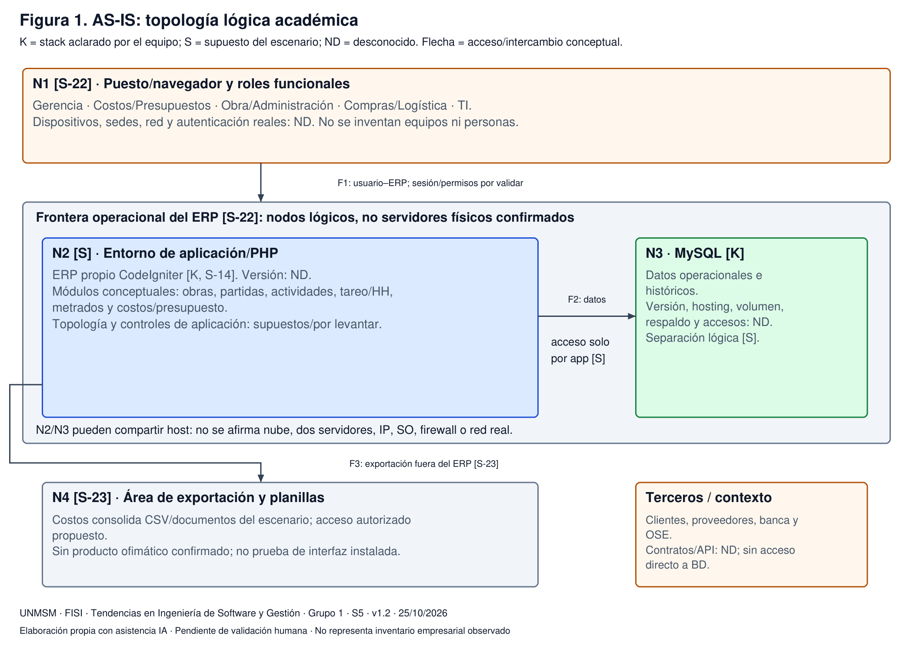
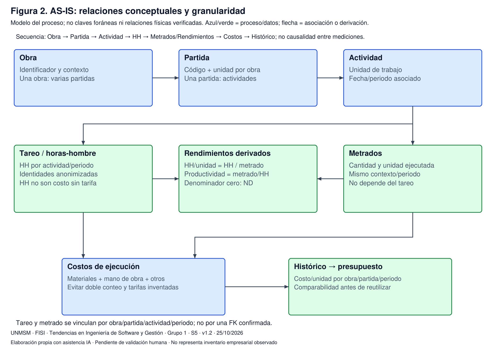
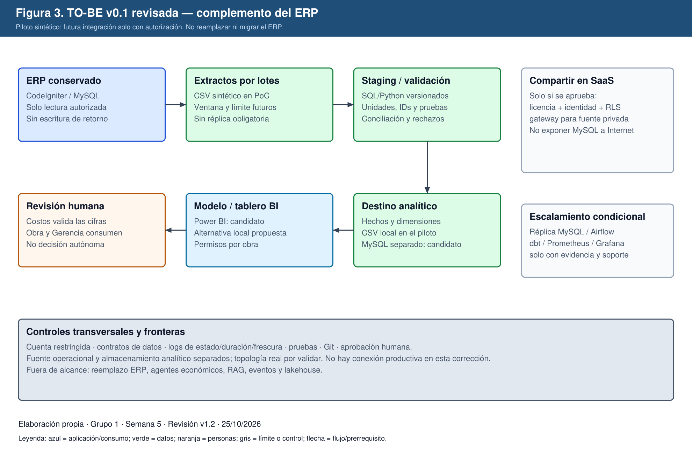
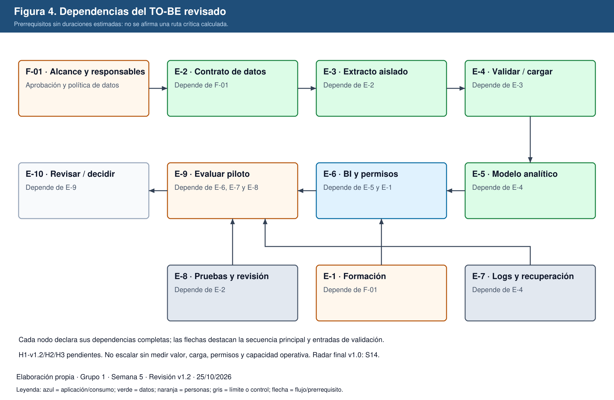

# Proyecto Integrador — Hito I v1.2

## Estrategia de adopción tecnológica 2026–2029

**Universidad Nacional Mayor de San Marcos — FISI — Ingeniería de Software.**
Curso: Tendencias en Ingeniería de Software y Gestión. Docente: Mg. PMP Yamil Quiñones Nieto.
Equipo: Grupo 1. Semana: 5, integración acumulativa S1–S5. Fecha: 25/10/2026. Versión: v1.2.
Integrantes: Anthony Romani, Max Astuhuaman, Guillermo Calle y Pablo Mendoza.
**Estado: Pendiente de validación humana.** Peso S5: 8 %; acumulado curricular S1–S5: 25 %, no calificación.

## 1. Control de cambios y naturaleza de la evidencia

La organización es Constructora Andina S.A.C., un caso ficticio académico. Se conserva el ERP propio CodeIgniter/MySQL, aclarado por el equipo en la revisión anterior. No se conocen sus versiones, servidores, licencias, controles o dotación reales. Esta versión no requiere acceder a producción ni sustituir el ERP.

Los originales S1–S5 y la v1.1 se conservan. Esta corrección no acredita entrega retroactiva, aprobación empresarial, autoría individual nueva o recalificación. La auditoría original permanece intacta. En esta versión, confirmado significa aclarado por el equipo o verificable en un archivo; supuesto significa condición del escenario, no observación empresarial; propuesto significa diseño no implantado; resultado histórico significa salida sintética anterior, no efecto de negocio.

| Cambio v1.2 | Antecedente v1.1 | Corrección y consecuencia |
|---|---|---|
| C-09 / H-02 | Infraestructura desconocida sin topología | Nodos lógicos supuestos, tres fronteras y relaciones conceptuales; no inventar inventario físico |
| C-10 / H-03 | Escala con niveles sin descriptores | Instrumento por dimensión; retirar puntuaciones no sustentadas y no promediar desconocidos |
| C-11 / H-04 | Metas internas sin fundamento suficiente | Fórmulas, fuente metodológica y presupuesto de tolerancias explícitos; justificación retrospectiva declarada |
| C-12 / H-05 | Control con costo real y ruido | Nuevo protocolo con mediana histórica independiente; sin resultados nuevos ni mezcla con el comparador anterior |
| C-13 / H-06/H-11 | Segmentos confundidos con canales; recursos visuales sin procedencia | Sustituto de presentación S2 en SVG/PDF, de elaboración propia; original se conserva como histórico |
| C-14 / H-07/H-12 | CAPECE atribuida a H1 2026 | Retiro de cifras no respaldadas; página observada 2024–2025, sin extrapolación al caso |
| C-15 / H-08 | Seis dimensiones dispersas o incompletas | Matriz complementaria para APIs, gobierno y SSDF; se conservan los tres Canvas previos |
| C-16 / H-09/H-10/H-13 | Identificación y vínculos mejorables | Registros v1.2, evidencia Git con límites y navegación vigente; ninguna aprobación humana simulada |

Los cambios C-01–C-08 de v1.1 siguen documentados en `documentos/proyecto/Semana5_Hito_I_v1.1.md`, §1. No se revierten la aclaración del stack, el diagnóstico hipotético ni el TO-BE proporcional.

## 2. Semana 1: caso, Charter, Radar y seis dimensiones

### 2.1 Organización y Charter consolidado

Constructora peruana ficticia de tamaño mediano. Usuarios: Gerencia, Obra, Costos/Presupuestos, Administración, Compras/Logística y TI. Clientes: contratantes privados y compradores inmobiliarios; sector público solo si el contrato del escenario lo requiere. Servicios: ejecución de obras y venta de unidades. El ERP registra información económica y operacional. Edificación, seguridad laboral y protección de datos son ámbitos regulatorios pertinentes; no se certifica cumplimiento legal ni aplicabilidad contractual concreta.

**Problema:** los históricos de costos, horas y metrados no se reutilizan integradamente para presupuestar nuevas obras y comparar previsto con ejecutado.
**Oportunidad:** convertir registros existentes en referencias de costo y rendimiento trazables antes de automatizar decisiones con IA.
**Objetivo general:** diseñar una estrategia de adopción tecnológica 2026–2029 que mejore planificación, presupuestación y control mediante información confiable.
**Objetivos específicos:** (1) caracterizar procesos y brechas; (2) evaluar integración, datos, analítica e ingeniería segura; (3) diseñar arquitectura proporcional; (4) diseñar experimentos sobre incertidumbres; (5) secuenciar capacidades con responsables, riesgos y decisiones.
**Alcance:** obras, partidas, actividades, tareo, metrados, costos, históricos, presupuesto y analítica complementaria.
**Exclusiones:** reemplazo del ERP, intervención productiva, cambios de planillas laborales y decisiones económicas autónomas.
**Restricciones:** entorno académico, datos sintéticos o anonimizados autorizados, infraestructura/capacidades no inventariadas y ausencia de presupuesto financiero real.
**Éxito preliminar:** trazabilidad origen–indicador, reglas explícitas, decisiones justificadas y experimentos reproducibles. No se atribuyen ahorros reales.

El Charter histórico ocupa una página en `entregas/semana-01/TISG_E01_S01_ProyectoIntegrador_2026-09-04.pdf`, p. 4. Su portada defectuosa no se reescribe. El registro S-08 refiere la brecha de §3.1 de ese documento, no una sección 3.3.

### 2.2 Technology Radar conservado

Editable: `entregas/semana-01/TISG_E01_S01_TechnologyRadar_v0.1_2026-09-04.svg`; exportaciones en `radar/exportado/`. Adoptar significa incorporar progresivamente una capacidad, no comprar un producto. Probar significa experimentar; Evaluar, investigar pertinencia; Esperar, postergar. No se cambian anillos en v1.2.

| ID | Tendencia | Cuadrante | Anillo | Justificación vigente |
|---|---|---|---|---|
| T1 | APIs e integración | Integración y arquitectura | Adoptar | Contratos cuando exista consumidor; CSV basta para el primer experimento |
| T2 | BI y analítica operacional | Datos y analítica | Adoptar | Comparar previsto–ejecutado y reutilizar históricos |
| T3 | Gobierno y calidad de datos | Datos y analítica | Adoptar | IDs, unidades y significado antes de decidir |
| T4 | Arquitectura analítica | Datos y analítica | Probar | Separar cargas y probar modelo acotado |
| T5 | IA generativa operacional | IA y automatización | Probar | Solo datos autorizados y revisión humana; no forma parte de la PoC S4 |
| T6 | RAG | IA y automatización | Evaluar | Necesidad documental no demostrada |
| T7 | Agentes de IA | IA y automatización | Esperar | No delegar acciones económicas |
| T8 | Eventos | Integración y arquitectura | Evaluar | No hay requisito probado de tiempo real |
| T9 | DevSecOps / SSDF | Ingeniería y operación | Adoptar | Pruebas, revisión, versionado y secretos fuera del repositorio |
| T10 | Observabilidad | Ingeniería y operación | Probar | Empezar por estado, duración y frescura |
| T11 | Platform Engineering / IDP | Ingeniería y operación | Esperar | Escala y fricción no dimensionadas |
| T12 | FinOps / AI FinOps | Ingeniería y operación | Evaluar | Aplicar al existir consumo variable material |

### 2.3 Impact Canvas: continuidad y complemento

Los tres Canvas iniciales siguen en S1, §7, pp. 9–10. Se integran sin exigir Canvas para tecnologías postergadas. La revisión distribuida se encuentra en v1.1 §§2.3/8.1/8.3; la matriz siguiente hace localizables las dimensiones de las seis capacidades recomendadas. SSDF usa la publicación final 1.1 (Souppaya et al., 2022), no el borrador 1.2 como norma final. Gobierno se apoya en el enfoque de producto de datos (Thoughtworks, 2025); ninguna fuente prescribe adoptar un producto específico.

| Tendencia | Valor | Arquitectura | Personas | Seguridad | Economía | Sostenibilidad |
|---|---|---|---|---|---|---|
| BI operacional | Comparación previsto–ejecutado y referencia de presupuesto | Modelo separado y tablero acotado | Costos valida definiciones; Obra interpreta desvíos | Acceso por obra y revisión de publicación | Comparar licencias/esfuerzo con horas medidas, sin ahorro inventado | Refrescos proporcionales y reutilización |
| Arquitectura analítica | Históricos comparables y reutilizables | Staging, transformaciones y modelo dimensional | Formación y responsable funcional de datos | Mínimo privilegio y conciliación | Medir operación antes de escalar | Retención acotada, evitar copias redundantes |
| IA generativa | Explicación asistida potencial, aún no validada | Acceso acotado futuro, sin escritura al ERP | Aceptación/rechazo humano | Fuga, alucinación e inyección como riesgos | Evaluar costo/utilidad antes de consumir | Preferir BI o reglas si bastan |
| APIs e integración | Evitar redigitación futura en P-03; no ingreso por API | Contrato de campos/unidades/versiones; API solo con consumidor, lote ahora | TI y Costos acuerdan cambios y soporte | Autenticación/autorización, mínimo privilegio y no exponer MySQL | Desarrollo y mantenimiento frente a errores/horas por medir | Lotes y paginación para no transferir datos innecesarios |
| Gobierno y calidad | Evitar ratios incomparables de P-01 | Diccionario, ID de obra/partida, unidades, linaje y reglas de rechazo | Costos es custodio propuesto; TI implementa, Obra corrige origen | Clasificar, minimizar, retener y limitar datos personales | Registrar costo de depuración y fallos; no suponer calidad gratuita | Reutilizar catálogo, evitar históricos duplicados y borrar según política aprobada |
| DevSecOps / SSDF | Cambios repetibles y menos fallos evitables, sin garantía cuantificada | Git, pruebas locales, revisión y plan de recuperación; CI condicional | Autor/revisor designados, formación en pruebas y secretos | Revisar dependencias, accesos y exposición antes de publicar | Contabilizar pruebas/revisión frente a retrabajo futuro | Reutilizar pruebas y ejecutar suites proporcionales, no infraestructura ociosa |

## 3. Semana 2: modelo de negocio y corrección bibliográfica

### 3.1 BMC AS-IS vigente

| Bloque BMC AS-IS | Contenido del escenario |
|---|---|
| Socios | Proveedores, subcontratistas, proyectistas y entidades financieras |
| Actividades | Presupuestar, ejecutar, tarear, medir, comprar, valorizar y atender posventa contractual |
| Propuesta de valor | Obras/unidades conforme a alcance, plazo, calidad y obligaciones contractuales |
| Relación con clientes | Contrato, reuniones de avance, valorizaciones y posventa |
| Segmentos | Contratantes privados y compradores inmobiliarios; públicos solo cuando corresponda |
| Recursos | Personal, equipos, capital, ERP propio e históricos; cantidades no confirmadas |
| Canales | Comerciales supuestos: fuerza/sala de ventas e invitaciones; digitales supuestos: web, redes, portales y correo al cliente |
| Costos | Mano de obra, materiales, subcontratos, equipos, logística, administración y TI |
| Ingresos | Contratos valorizados, venta de unidades y adicionales reconocidos; no SaaS ni monetización de APIs |

El ERP es recurso/soporte de operación interna, no segmento de clientes ni canal comercial de entrega al cliente. Pagos bancarios son mecanismo de cobro supuesto, no un nuevo ingreso. La posventa es actividad/relación; no se añade como flujo de ingreso salvo contrato y evidencia futuros.

La presentación histórica `entregas/semana-02/Grupo 1 - Proyecto - S2.pdf`, p. 1, ubica fuerza de ventas, licitaciones y web en segmentos. Se sustituye para uso vigente por `entregas/semana-02/revision-v1.2/Presentacion_S2_v1.2.pdf` y su fuente `documentos/proyecto/Semana2_MaterialComplementario_v1.2.md`; los SVG de sus cinco láminas son editables. No se modificó ni se afirma corregido el PDF original.

| Propuesta | Cambio y efecto económico | Beneficio esperado | Riesgo principal | Validación |
|---|---|---|---|---|
| P-01 | Históricos gobernados; eficiencia/costo, no ingreso nuevo | Presupuestar y detectar desvíos | Calidad/comparabilidad | Nuevo diseño S4 y posterior contraste autorizado |
| P-02 | Portal informativo acotado; valor percibido | Transparencia y menos consultas | Publicar información errónea/confidencial | Piloto posterior; fuera del TO-BE inicial |
| P-03 | Integración de abastecimiento; eficiencia interna | Menor redigitación | Capacidad y dependencia de terceros | Diagnóstico de proveedores; sin eventos obligatorios |

SaaS se considera consumo potencial, no producto propio. Una plataforma se limita a participantes del caso, no marketplace abierto. API economy se orienta a integración, no venta de APIs. e-Business se ajusta a compras y documentación. e-Commerce queda como posibilidad de captación/reserva/pago, sin prometer cierre íntegro en línea. La elección depende del proceso contractual hipotético, no de extrapolar estadísticas nacionales (Postman, 2025, solo como contexto tecnológico).

### 3.2 CAPECE: retiro explícito de afirmaciones

La consulta del 25/10/2026 a `https://www.capece.org.pe/observatorio-ecommerce/` muestra el encabezado «Comercio Electrónico Perú 2024–2025». No se descargó el informe mediante formulario ni se entregaron datos personales. Se verifica la página, no todos los datos del informe completo (Cámara Peruana de Comercio Electrónico, s. f.).

| Afirmación histórica S2 | Localización original | Tratamiento vigente v1.2 |
|---|---|---|
| Billeteras 37,6 % en H1 2026 | §2.5, p. 5 | Retirada: el enlace no respalda esa cifra/periodo |
| Mercado US$19 300 millones en H1 2026 | §4.5, p. 8 | Retirada: no sustituida por otra cifra sin contexto verificable |
| Crecimiento 50,4 % | §4.5, p. 8 | Retirado por falta de respaldo de la edición atribuida |
| Más de 1 000 millones de transacciones y billeteras como principal medio | §4.5, p. 8 | Retirado junto con la inferencia de pago digital como estándar |
| El mercado confirma D-10 | §6, p. 12 | Se retira ese fundamento; D-10 se mantiene por alcance contractual supuesto |
| Observatorio H1 2026 como G-02 | §§8/10, pp. 13/15 | Sustituido por referencia a la página 2024–2025, sin usarla como benchmark |

Texto sustitutivo: «El escenario admite captación y coordinación digital; reserva y pago se evaluarán según contrato, autorización y capacidad. No se presupone demanda, ahorro o ingreso a partir de cifras nacionales no verificadas». Registro detallado: `fuentes/revision-v1.2/VERIFICACION_FUENTES.md`.

Los supuestos económicos SE-01–SE-10 se preservan en el libro v1.2: ingresos contractuales; costos directos; TI fija no medida; reprocesos hipotéticos; transparencia sin ingreso garantizado; costo incremental del portal; medir horas/discrepancias antes de monetizar; sin comisiones/publicidad propias; proveedores por evaluar; gasto variable condicionado.

## 4. Semana 3: instrumento de madurez y plan de cambio

### 4.1 Método y escala

**Instrumento académico propio, no modelo certificado ni medición empresarial.** DORA (2025) y Boyagi (2025) orientan capacidades y fricción, no puntúan esta organización. La v1.1 asignaba niveles con poco sustento; la v1.2 no convierte desconocimiento en inmadurez.

Escala: N1 = práctica aislada/reactiva explícitamente descrita; N2 = repetición local documentable; N3 = definición común con responsable; N4 = medición y seguimiento; N5 = mejora verificada por ciclos. **ND = No determinado**, no cero ni N1.

Regla: para cada dimensión, registrar fuente, indicador y alcance; asignar el mayor nivel cuyos descriptores y prerrequisitos estén sustentados. En el caso ficticio, una condición asumida puede justificar solo un nivel hipotético, rotulado H; no acredita nivel empírico. Sin información suficiente, ND. No promediar ordinales ni imputar ND. El objetivo N3 es propuesto y no equivale a una brecha numérica medida.

| Dimensión del instrumento | N1 aislado | N2 repetible local | N3 definido común | N4 medido | N5 mejora verificada |
|---|---|---|---|---|---|
| Cultura | Acuerdos individuales reactivos | Rutina local de revisión | Acuerdos compartidos y dueño | Seguimiento de acuerdos y feedback | Ajustes y efecto documentado |
| Colaboración | Traspasos informales aislados | Intercambio local repetido | Entregables y responsables comunes | Tiempo/errores de traspaso medidos | Reducción sostenida verificada |
| DevEx | Ejecución dependiente de memoria | Guía local repetible | Pruebas/guías mantenidas y revisión | Fricción y fallos medidos | Mejora de flujo verificada |
| Equipos virtuales | Coordinación remota ocasional sin regla | Canal y rutina locales | Acuerdo asíncrono y repositorio común | Esperas/handoffs medidos | Ajustes de coordinación evaluados |
| Datos | Registros aislados sin rutina descrita | Registro estructurado recurrente, sin contrato común | IDs/unidades/reglas y custodio común | Calidad/frescura seguidas | Calidad mejora por ciclos |
| Seguridad | Respuesta reactiva expresamente descrita | Accesos/revisión locales repetidos | Política, matriz y responsables | Pruebas/revisión de accesos periódicas | Tratamientos y eficacia revisados |
| Capacidad de cambio | Reacciones puntuales descritas | Piloto local repetido | Plan, dueño y criterios de adopción | Uso/carga de cambio medidos | Aprendizaje modifica el plan |
| Habilidades | Dependencia individual descrita | Transferencia local recurrente | Mapa de roles y formación común | Evaluación de desempeño y brechas | Formación ajustada por resultados |
| Postura ante IA | Uso sin reglas expresamente supuesto | Revisión local repetida | Política de datos y autonomía | Evaluación de errores y uso | Revisión de riesgos y beneficio |

### 4.2 Asignación revisada y acciones

| Dimensión evaluada | Nivel v1.1 | Nivel v1.2 | Sustento y límite | Acción vinculada / evidencia futura |
|---|---|---|---|---|
| Cultura | 2 | No determinado | S3 hipotético no establece acuerdos observables suficientes | Gerencia: co-diseño, registrar acuerdos y revisión |
| Colaboración | 2 combinado | No determinado | Exportaciones no acreditan rutina de colaboración | Obra/Costos: definir handoffs y registrar tiempos |
| DevEx | 2 | No determinado | No existe inventario de prácticas del equipo ERP | TI: levantar guías/pruebas y medir fricción |
| Equipos virtuales | 2 combinado | No determinado | Dispersión y prácticas remotas no confirmadas | Operaciones: validar sedes/canales; acuerdo asíncrono si aplica |
| Datos | 2 | 2-H, solo escenario | S-08 y registro ERP recurrente supuesto S-24: cumple N2; no contrato común N3 | Costos/TI: diccionario, conciliación y custodio; revisar muestra autorizada |
| Seguridad | 2 | No determinado | Controles desconocidos; no prueba de ausencia | TI/seguridad: inventario y matriz; pruebas permitidas/denegadas |
| Capacidad de cambio | 1 | No determinado | Adopción no medida no demuestra N1 | Gerencia/Costos: plan, responsables y piloto con feedback |
| Habilidades | 2 | No determinado | No hay evaluación individual de competencias ERP | TI/Costos: evaluar tareas y formación acotada |
| Postura ante IA | 1 | No determinado | No conocer política no implica ausencia de política | Equipo/seguridad: validar política antes de usar datos |

El único nivel conservado es una inferencia hipotética, no diagnóstico empírico. La falta de sustentación de la mayoría de dimensiones queda pendiente; documentar el instrumento no crea evidencia de campo. Objetivo propuesto N3 en todas las dimensiones aplicables, sujeto a revisión de viabilidad humana.

### 4.3 Stakeholders, brechas y adopción

| Stakeholder | Influencia | Interés | Impacto | Estrategia | Base |
|---|---|---|---|---|---|
| Gerencia | Alta | Alto | Alto | Acordar alcance y continuidad | Rol del escenario, no entrevista |
| Costos/Presupuestos | Alta | Alto | Muy alto | Definir ratios, casos y aceptación | Usuario principal supuesto |
| Obra/Administración | Alta | Medio-alto | Alto | Captura simple y devolución de desvíos | Hipótesis funcional |
| Compras/Logística | Alta | Alto | Alto | Homologar catálogo y conciliar | P-03 propuesta |
| TI | Alta | Alto | Alto | Piloto mantenible y accesos | Stack aclarado; skills/dotación ND |
| Seguridad/administración TI | Alta | Alto | Alto | Revisar permisos y retención | Función propuesta, no nuevo puesto confirmado |
| Clientes | Media | Alto | Alto | Información sin exponer costos internos | Portal fuera de primer piloto |
| Campo | Baja-media | Medio | Medio | Explicar finalidad; evitar vigilancia indebida | No cambiar jornada/planilla |

| Rol del escenario | Actual / brecha hipotética | Objetivo propuesto | Acción y responsable | Horizonte organizacional |
|---|---|---|---|---|
| Costos | Planilla local e históricos no integrados | Ratios con definiciones comunes | Taller y validación de unidades; Costos | Q1 2027, por validar |
| Compras | Codificación dispersa supuesta | Catálogo homologado | Acuerdo y muestras de conciliación; Logística | Q1 2027, por validar |
| Desarrollo ERP | Prácticas de extracción/pruebas ND | Extracción segura reproducible | Evaluación de skills antes de formación SQL/Python; TI | Q1–Q2 2027, por validar |
| Administración TI | Accesos/recuperación ND | Permisos y recuperación definidos | Inventario y ensayo autorizado; TI/seguridad | Antes de compartir datos |
| Jefatura de obra | Interpretación de indicadores ND | Interpretar desvíos sin decisiones automáticas | Taller con casos sintéticos; Operaciones | Antes de piloto humano |
| Custodio de datos | Función no formalizada en el escenario | Definiciones y aceptación a cargo de Costos | Asignar función, no crear puesto por defecto; Gerencia | Antes de extracción |

Cinco resistencias hipotéticas: carga de registro, dependencia de planillas, temor a complejidad, oposición a homologar códigos y distancia obra/sede. Acciones respectivas: captura mínima, paralelo limitado, guion sencillo, acuerdos de catálogo y devolución de tableros. No se afirma que ocurrieran. Comunicación propuesta: sesión inicial de alcance con Gerencia/Costos, guía corta para Obra, registro asíncrono de dudas y revisión semanal durante el piloto; responsables por confirmar.

Plan: Q4 2026, acordar alcance/responsables; Q1 2027, preparar datos y formación según diagnóstico; Q2 2027, piloto autorizado y marcha en paralelo; después, evaluar. Son horizontes del escenario, no ejecución ni semanas académicas. H2 no presupone una cantidad de personal TI; si no hay capacidad asignada se modifica el calendario.

## 5. Semana 4: hipótesis, métricas y protocolo independiente

### 5.1 Propuesta de valor e hipótesis

Usuario principal: Costos/Presupuestos; secundarios: Obra y Gerencia. Tareas: presupuestar y explicar desvíos. Dolores hipotéticos: referencias dispersas y diferencias entre cifras. Ganancias esperadas: ratios comparables, trazabilidad y oportunidad. Aliviadores: reglas de calidad y referencia por partida. Creadores de ganancia: estimación con históricos y comparación previsto–ejecutado. Es un lienzo equivalente, no validación con usuarios.

| Hipótesis | Diseño y métrica | Continuar | Modificar | Detener / estado |
|---|---|---|---|---|
| H1-v1.2: ratio histórico ponderado mejora error frente a mediana histórica | Separar seis obras cerradas y obra nueva; MAPE y reducción relativa sobre mismas partidas | MAPE ≤15 % y reducción ≥30 %, cobertura 100 % de partidas previstas y sin fuga | Datos válidos pero falla una meta; baseline cero; historial insuficiente | Detener evaluación ante fuga/datos inválidos; detener esa variante si MAPE >30 %. **No ejecutada** |
| H2: flujo aislado viable en esfuerzo acotado | Extraer sintético, validar/cargar, modelo, tablero, permisos, logs y reproducción; horas-persona | Todas las etapas verificadas en ≤160 h-persona y sin conexión productiva | Falta una etapa o excede presupuesto; replanificar | Acceso no autorizado/daño; no continuar conexión. **Pendiente** |
| H3: adopción y menor tiempo total | Piloto humano autorizado cuatro semanas; uso útil semanal y comparación de tiempos pareados | Uso ≥70 % cada semana y reducción mediana ≥80 %, calidad no inferior | Falla un umbral con evidencia válida; muestra insuficiente o abandono | Expansión detenida si ahorro ≤0, errores dañinos o acceso indebido. **Pendiente** |

### 5.2 Definiciones y fundamento metodológico

Se elige MAPE para comparar error relativo entre partidas de distinta magnitud, con peso igual por partida; no mide impacto monetario total. Se añade error absoluto monetario por partida y suma de errores absolutos como diagnóstico, sin nueva meta universal. Scikit-learn developers (s. f.-b) documenta MAPE y su inestabilidad cerca de cero; aquí se expresa en porcentaje y se rechaza costo real ≤0, en vez de dividir por epsilon. No se instaló ni se requiere scikit-learn.

| Métrica | Fórmula y unidad | Registro / escenario | Motivo y tratamiento de extremos |
|---|---|---|---|
| APE de partida | 100 × abs(predicho − real) / abs(real), % | Cada partida con costo real positivo | Identificar casos que el promedio oculta; no es intervalo ±15 % |
| MAPE | Suma de APE / n, % | Mismas partidas para ambos métodos | Comparabilidad relativa; n=0 o real no positivo invalida el caso |
| Reducción relativa | 100 × (MAPE B0 − MAPE M1) / MAPE B0, % | Baseline B0 y método M1 independientes del real de evaluación | Baseline cero: ND, no dividir ni declarar mejora relativa |
| Cobertura | 100 × partidas con histórico suficiente / partidas previstas, % | Antes de evaluar; mínimo dos referencias por partida | Reportar faltantes, nunca elegir solo las partidas favorables |
| Esfuerzo H2 | Suma de horas-persona de preparación, desarrollo, revisión, pruebas y operación | Registro por tarea/persona, sin inferir autoría histórica | Evita confundir cuatro semanas calendario con esfuerzo disponible |
| Uso útil H3 | 100 × usuarios habilitados que completan tarea definida / usuarios habilitados al inicio de semana, % | Tarea: consultar comparación, interpretar y registrar una revisión; no solo login | Denominador congelado por semana; bajas/retiros explicados; cero habilitados = ND |
| Tiempo H3 | 100 × mediana((t_antes − t_después) / t_antes), % | Misma tarea/unidad de alcance, orden contrabalanceado, preparación/revisión/retrabajo incluidos | t_antes >0; mantener fallos y abandonos; sin línea base no hay porcentaje |

Los porcentajes internos originales se conservan para continuidad, pero su fundamentación se formula **retrospectivamente el 25/10/2026**. No es preregistro del experimento de 2026-10-02 ni se afirma que se derivaron antes de ver sus resultados. Las fuentes respaldan métodos, no esos números. No se usa AACE para justificar MAPE ni cifras sectoriales no verificadas.

| Umbral interno | Razonamiento reproducible del escenario | Límite / revisión |
|---|---|---|
| MAPE 15 % | Presupuesto didáctico de error relativo: 5 puntos por heterogeneidad de obra + 5 por calidad/unidades + 5 por simplificación del estimador =15; sumar es una asignación conservadora de tolerancia, no descomposición estadística | Componentes asumidos, no medidos; ensayar tolerancias 10/15/20 % y no cambiar la principal después de evaluar |
| Reducción 30 % | Exigir conservar como máximo 70 % del error del comparador para justificar complejidad adicional; si B0 tuviera 20 %, meta comparativa 14 %, además de límite 15 % | Ejemplo algebraico, no resultado ni benchmark; comparar sensibilidad 20/30/40 % |
| Abandono >30 % MAPE | Duplicar tolerancia principal 2 ×15=30: no ampliar una variante cuyo error medio exceda ese margen | No abandona todo BI ni borra resultado adverso; revisar en validación humana |
| H2 ≤160 h-persona | Presupuesto académico propuesto de cuatro unidades de 40 h-persona: preparación, pipeline/modelo, tablero/permisos y pruebas/revisión | Equivale a cuatro semanas de referencia de 40 h, no dotación ni plazo empresarial garantizado |
| H3 ≥70 % | Permitir como máximo 30 % de no uso por curva de aprendizaje sin perder mayoría operativa; exigirlo cada semana evita ocultar abandono final | Con N habilitados, mínimo techo(0,70×N); no evidencia satisfacción ni escala |
| H3 ≥80 % menos tiempo | Objetivo exigente: tiempo completo posterior ≤1/5 del anterior; se plantea para que la reducción compense preparación/revisión que también se contabilizan | Aspiración a falsar, no ahorro esperado demostrado; si la tarea manual no tiene margen suficiente, se modifica el diseño antes del piloto |
| Cuatro semanas H3 | Cuatro ciclos semanales de uso y feedback; observar cada ciclo, no solo día favorable | No demuestra adopción sostenida; muestra humana/conveniencia y efecto aprendizaje se informan |

El supuesto histórico de hasta 15 días de consolidación no es un dato ni una base válida para calcular ahorro. El tiempo futuro debe cronometrarse. La decisión continuar/modificar/detener usa las reglas de §5.1 con prioridad de seguridad y validez del dato sobre desempeño.

### 5.3 Diseño corregido, sin resultados nuevos

Protocolo completo: `poc/POC-01-estimacion-historicos/revision-v1.2/DISENO_EXPERIMENTAL.md`. B0 = cantidad presupuestada × mediana de costos unitarios históricos por partida; M1 = cantidad × suma(costos históricos)/suma(metrados históricos). Ambos usan los mismos históricos y unidades. La mediana es una regla sencilla robusta a extremos, no un presupuesto humano observado (Python Software Foundation, s. f.). No hay garantía de que M1 supere a B0.

Predicción solo recibe registros de obras cerradas OB-C01–OB-C06 (2021–2026), cantidades presupuestadas de OB-N01 (2027 en el conjunto sintético) y unidades; no recibe `obra_nueva_real.csv`, catálogo generador de costos ni datos de ejecución de OB-N01. Evaluar después con la verdad separada. La separación previene información futura (Scikit-learn developers, s. f.-a). El conjunto conocido es retrospectivo/exploratorio; un archivo separado no convierte estos datos ya inspeccionados en prueba ciega nueva.

Sensibilidad predefinida: retirar cada obra histórica sucesivamente; usar últimos 2/4/6 años disponibles; contaminar una tarifa histórica +30 % en una copia; cambiar cantidades ×0,5/×2; validar casos sin histórico o costos cero. Reportar todos los escenarios, cobertura, MAPE de ambos, reducción y decisión; no seleccionar la mejor semilla. Los escenarios pendientes no generan métricas inventadas.

**Estado v1.2: diseño documentado, no ejecutado.** Se verificará documentalmente la separación y las fórmulas; no se ejecutan los generadores/verificadores antiguos porque sobrescriben CSV/resultados. El diseño cumple la exigencia S4 sin convertir ejecución adicional en requisito.

### 5.4 Resultado histórico preservado, no transferible

| Métrica histórica v1.1 | Valor preservado | Interpretación permitida |
|---|---|---|
| MAPE control con ruido | 20,19 % | Comparador artificial dependiente del real conocido |
| MAPE método analítico | 11,31 % | Solo seis partidas del escenario sintético fijo |
| Reducción relativa | 43,98 % | No comparable con B0 mediana sin nueva ejecución |
| CIM-01 / INS-02 | 15,87 % / 15,10 % | Superan individualmente 15 %, pese al promedio menor |

Estos resultados proceden de v1.1 y la auditoría original, no de una ejecución nueva. Se conserva el CSV `poc/POC-01-estimacion-historicos/resultados/resultados.csv` y su evidencia. No hay significancia, generalización, ahorro, adopción, tablero ni validación de HH/unidad demostrados. El Canvas BI de §2.3 conecta valor con H1, arquitectura con H2 y personas con H3.

## 6. Semana 5: AS-IS conceptual con infraestructura y fronteras

### 6.1 Topología mínima explícitamente supuesta

| Elemento | Clasificación y supuesto | Responsabilidad / acceso | Límite de conocimiento |
|---|---|---|---|
| ERP propio CodeIgniter / MySQL | Aclaración del equipo, S-14 | Registro operacional | Versiones, código y esquema no inspeccionados |
| N1: puesto/navegador de usuario | Supuesto S-22 | Gerencia, Costos, Obra y Compras acceden por interfaz | No confirma equipos, sedes, red ni producto |
| N2: entorno lógico aplicación/PHP | Supuesto S-22; stack aclarado | CodeIgniter y módulos conceptuales de obra, partidas, actividades, tareo, metrados, costos/presupuesto | No equivale a servidor físico, SO ni hosting conocido |
| N3: almacenamiento lógico MySQL | Stack aclarado; separación lógica S-22 | Persistencia operacional e histórica; acceso por aplicación supuesto | N2/N3 podrían compartir host; no afirmar dos servidores |
| N4: área de exportación/planilla | Supuesto S-23 | Costos consolida exportaciones del caso | No confirma Microsoft 365 ni formatos productivos |
| Terceros: clientes/proveedores/banca/OSE | Actores/contexto, integraciones reales ND | Intercambio documental/comercial del escenario | Sin contrato API inventado; sin acceso directo supuesto a MySQL |

Frontera F1 usuario–ERP: sesión/autorización por verificar; HTTPS es control propuesto, no observado. F2 aplicación–datos: cuenta y permisos por inventariar; no acceso directo de clientes. F3 salida de extractos: datos dejan la frontera operacional y pueden perder controles; minimizar, autorizar y registrar exportación como controles propuestos. Los límites lógicos no describen VLAN, IP, cloud o firewall reales.

### 6.2 Datos, granularidad e integraciones

Cadena de lectura: **Obra → Partida → Actividad → Tareo / Horas-hombre → Metrados / Rendimientos → Costos → Histórico**. Es un modelo conceptual del proceso, **no relaciones físicas exactas ni claves foráneas verificadas**. Tareo y metrado son mediciones paralelas asociadas por obra/partida/actividad/periodo; uno no causa ni genera automáticamente al otro. El rendimiento se deriva de ambas.

| Relación conceptual | Granularidad / regla del escenario | Precaución |
|---|---|---|
| Obra → Partida | Una obra contiene múltiples partidas; código y unidad contextualizados | Catálogo puede reutilizar códigos entre obras; usar ID compuesto |
| Partida → Actividad | Una partida puede desagregarse en actividades | Correspondencia propuesta, no esquema SQL confirmado |
| Actividad → Tareo | Registro de horas por actividad/fecha o periodo; personas anonimizadas | No publicar identificadores laborales ni equiparar horas a costo sin tarifa |
| Actividad → Metrado | Cantidad ejecutada y unidad por actividad/periodo | Unidades y periodo comparables antes de agregar |
| HH + Metrado → Rendimiento | HH/unidad = HH / cantidad; productividad = cantidad / HH | Denominador cero = ND; no implementado/validado por la PoC de costos |
| Ejecución → Costos | Materiales + mano de obra + otros componentes del alcance | Evitar doble conteo; no inferir costos reales a partir de horas sin tarifas |
| Costos + cantidades → Histórico | Costo/unidad por obra/partida/periodo y condiciones | Homologar moneda, fecha, unidad y tipología antes de usar empresarialmente |
| Histórico → presupuesto/control | Referencia de nueva obra; contraste previsto–ejecutado | No mezclar evaluación futura con referencia |

Integración AS-IS supuesta: interfaz ERP → consulta MySQL → exportación → planilla/conciliación de Costos. No se afirma API nueva ni integración SUNAT/OSE instalada. Respaldos, recuperación, conectividad real y controles quedan desconocidos; el diagrama no demuestra su ausencia.

## 7. Deuda y trazabilidad

P1 = confiabilidad/confidencialidad previa; P2 = repetibilidad/operación del piloto; P3 = optimización posterior. Priorización cualitativa del escenario, no incidentes ni riesgo medido.

| ID | Problema/requisito | Prioridad | Base | Decisión | Componente/respuesta |
|---|---|---|---|---|---|
| DT-01 | Históricos no comparables | P1 | S-08 | ADR-04 | Modelo y unidades comunes |
| DT-02 | Definiciones no acordadas | P1 | S-24 | ADR-04 | Diccionario/custodio |
| DT-03 | Extractos no reproducibles supuestos | P2 | H2 | ADR-02 | Extractor por lotes |
| DT-04 | Previsto–ejecutado disperso | P1 | P-01/H1 | ADR-04 | Hechos y dimensiones |
| DT-05 | Posible carga sobre ERP | P1 | Riesgo no medido | ADR-02 | Extracción acotada/destino separado |
| DT-06 | Transformaciones sin versionar supuestas | P2 | DevEx ND | ADR-03 | SQL/Python en Git |
| DT-07 | Error de carga poco visible supuesto | P2 | H2 | ADR-06 | Logs/alerta simple |
| DT-08 | Pruebas/despliegue no inventariados | P2 | DevEx ND | ADR-06 | Pruebas/revisión propuestas |
| DT-09 | Accesos económicos no inventariados | P1 | Seguridad ND | ADR-05 | Matriz de permisos |
| DT-10 | Criterios individuales supuestos | P3 | Cultura ND | ADR-04 | Acuerdos y responsables |
| DT-11 | Adopción/ahorro no medidos | P1 | H3 pendiente | ADR-05 | Línea base y piloto humano |

## 8. TO-BE v0.1 revisada y decisiones arquitectónicas

### 8.1 Responsabilidades y proporcionalidad

ERP CodeIgniter/MySQL → extractos autorizados por lotes → staging aislado → validación y SQL/Python versionados → almacenamiento analítico separado → modelo/tablero → revisión de Costos. No hay escritura de resultados de costo al ERP. No se duplican venta, facturación o planilla.

Piloto: archivos sintéticos locales, ejecución manual reproducible. Destino organizacional candidato: MySQL analítico independiente, hechos ejecución/presupuesto y dimensiones obra/partida/tiempo, sin asumir réplica ni disponibilidad. Cuenta futura de solo lectura, vistas aprobadas, lotes pequeños, ventana y límite de duración; medir carga antes de conectar. Sin ventana segura, detener extracción y evaluar copia autorizada/réplica, no imponerla.

Power BI Desktop es candidato, no licencia confirmada. Compartir por Service requiere licencia, identidades, roles y autorización. Un gateway conecta fuentes privadas mediante conexiones salientes (Microsoft, 2026a). RLS limita Viewer, no Admin/Member/Contributor (Microsoft, 2026b); probar acceso permitido/denegado. No exponer MySQL a Internet ni enviar datos personales a SaaS sin permiso. Alternativa local si evita costo/exposición.

Base mínima: guion/programador aprobado, SQL/Python, Git, pruebas y logs. Evaluar réplica solo si no hay ventana segura; Airflow ante dependencias/reintentos inmanejables; dbt ante muchos modelos y soporte compatible; Prometheus/Grafana ante servicios/alertas sostenidos; CI ante repositorio/runner/secretos autorizados. Ninguno es requisito de implementación S5. RAG, agentes, eventos y lakehouse siguen fuera del primer TO-BE.

### 8.2 Seis ADR conservadas y precisadas

| ID | Decisión | Alternativas | Trade-off | Fundamento | Riesgo/condición |
|---|---|---|---|---|---|
| ADR-01 | Conservar ERP CodeIgniter/MySQL | Reemplazar, reescribir, complementar | Dependencia de código existente vs migración injustificada | D-02 y aclaración; CodeIgniter Foundation (2022) no identifica versión instalada | Inventariar antes de intervenir |
| ADR-02 | Lotes acotados y destino separado | BI directo, copia completa, réplica | Frescura diferida y carga residual vs aislamiento de consultas | DT-05 y principio de minimizar carga; referencia Oracle histórica no revalidada | Medir ventana y permisos; no prometer impacto cero |
| ADR-03 | SQL/Python versionados y ejecución simple | Airflow/dbt, ETL manual | Disciplina manual vs infraestructura adicional | DT-03/06; Souppaya et al. (2022) | Probar idempotencia y recuperación |
| ADR-04 | Modelo obra/partida/tiempo y contrato | Planillas separadas, esquema genérico | Homologación necesaria vs indicadores comparables | P-01; Thoughtworks (2025); H1-v1.2 pendiente | Costos aprueba unidades/granularidad; no afirmar modelo desplegado |
| ADR-05 | BI local; compartir condicionado | Tablero ERP, autoalojado, Service | Menos operación de presentación vs costo/flujo externo | H3 pendiente; Microsoft (2026a, 2026b) | Licencias, permisos, piloto y revisión |
| ADR-06 | Logs, pruebas y revisión desde piloto | Informalidad, stack completo | Menor automatización inicial vs mantenibilidad | DT-07/08; SSDF 1.1 final | Responsable operativo por designar |

Fecha documental 25/10/2026; aprobación del equipo pendiente. Las decisiones son propuestas académicas, no cambios empresariales ejecutados. Las ADR v1.1 se preservan; no se cambia su función por popularidad tecnológica.

## 9. Dependencias, riesgos y coherencia progresiva

| ID | Habilitador | Depende de | Criterio de avance | Responsable propuesto |
|---|---|---|---|---|
| F-01 | Alcance y datos | — | Validación humana y política | Equipo/Gerencia |
| E-1 | Formación mínima | F-01 | Evaluación de skills y guía | TI/Costos |
| E-2 | Contrato de datos | F-01 | IDs/unidades/granularidad/permisos | Costos/datos |
| E-3 | Extracto aislado | E-2 | Manifiesto, separación de objetivos futuros | TI |
| E-4 | Validación y carga | E-3 | Pruebas, conciliación y repetición | TI |
| E-5 | Modelo separado | E-4 | Hechos y fórmulas revisados | TI/Costos |
| E-6 | BI y permisos | E-5, E-1 | Casos de uso/acceso revisados | Costos/TI |
| E-7 | Logs/recuperación | E-4 | Fallo visible y repetición ensayada | TI |
| E-8 | Pruebas/revisión | E-2 | Versionado y pruebas; no depende de Airflow | TI/revisor |
| E-9 | Evaluación del piloto | E-6, E-7, E-8 | Medir H1-v1.2/H2/H3 antes de escalar | Costos/equipo |
| E-10 | Revisar Radar/arquitectura | E-9 | Continuar/modificar/detener documentado | Equipo |

No hay duraciones estimadas para una ruta crítica. E-1/E-8 empiezan temprano; cuatro semanas de H2 son presupuesto de esfuerzo, no cronograma global.

Riesgos R-01 calidad: contrato y conciliación; R-02 sobreingeniería: base mínima; R-03 carga ERP: ventana y medición; R-04 acceso: mínimo privilegio; R-05 IA incorrecta: revisión humana; R-06 fuga/inyección: datos autorizados y herramientas acotadas; R-07 skills: evaluación y formación; R-08 costo: licencia/presupuesto antes de compartir; R-09 confidencialidad: sintéticos; R-10 baja adopción: co-diseño y H3. Responsables propuestos: Costos/datos para R-01/10, TI para R-02/03/07, seguridad/TI para R-04/06/09, revisor de negocio para R-05 y Administración para R-08. No se asignan probabilidades ni eficacia real sin evidencia.

| Vínculo | Evidencia de coherencia | Límite |
|---|---|---|
| S1 → S2 | Brecha de históricos → P-01, no nuevos ingresos ficticios | P-02/03 no se fuerzan al primer piloto |
| S2 → S3 | Catálogo/datos requieren Costos, Logística y formación | Capacidad real y aprobación ND |
| S3 → S4 | Experimento sintético aislado; no requiere entrevistas/productivo | Piloto humano futuro condicionado |
| S4 → S5 | Staging/modelo apoyan H1; flujo completo H2; tablero/feedback H3 | Arquitectura diseñada no prueba hipótesis |
| S1 → S5 | Adoptar capacidades de datos/integración/SSDF; IA subordinada | Sin cambio de anillos ni reemplazo ERP |

## 10. Registros versionados y contribuciones

Libro integral: `gestion/registros/Registros_y_Radar_Semana5_v1.2.xlsx`. Se parte de una copia de v1.1, conservando tablas históricas de contribuciones y fuentes; se actualizan tablas vigentes y se añaden instrumento, métricas, supuestos, fuentes y revisión humana. No se guardó sobre ningún libro original. Las hojas históricas conservadas están identificadas como antecedente, no evidencia revalidada.

### 10.1 Decisiones y supuestos adicionales

D-01–D-16 se preservan del registro anterior con sus fechas/estados, y D-10/D-12 reciben notas de fundamento actualizado, sin retrofechar. Las nuevas decisiones siguientes están propuestas documentalmente, no aprobadas por el equipo.

| ID nuevo | Fecha | Decisión y alternativa | Motivo / consecuencia | Estado |
|---|---|---|---|---|
| D-17 | 25/10/2026 | Modelar nodos lógicos supuestos, no inventario físico | H-02; completa guía sin divulgar producción | Pendiente de validación humana |
| D-18 | 25/10/2026 | ND frente a puntuaciones sin instrumento | H-03; datos 2-H solo bajo S-24, sin promedio | Pendiente de validación humana |
| D-19 | 25/10/2026 | Baseline mediana, no real×ruido | H-05; nuevo protocolo sin ejecución ni resultados mezclados | Pendiente de validación humana |
| D-20 | 25/10/2026 | Fundamentar metas conservadas, no presentarlas como benchmark | H-04; razonamiento retrospectivo y sensibilidad futuros | Pendiente de validación humana |
| D-21 | 25/10/2026 | Retirar CAPECE no respaldada y sustituir presentación | H-06/07/11; originales conservados | Aplicada documentalmente; validación humana pendiente |
| D-22 | 25/10/2026 | Completar seis dimensiones sin ampliar stack | H-08; capacidades, no productos impuestos | Pendiente de validación humana |

| Supuesto nuevo | Enunciado | Tipo / validación |
|---|---|---|
| S-22 | Puesto/navegador, ejecución aplicación y almacenamiento son nodos lógicos separados | Topología académica; no cantidad de servidores o redes reales |
| S-23 | Exportación a planillas y salida de frontera operacional | Escenario; validar proceso y acceso antes de intervenir |
| S-24 | Registro estructurado recurrente sin contrato común reutilizable | Condición hipotética que sostiene datos 2-H; no observación |
| S-25 | Presupuesto de tolerancias 5+5+5 puntos y esfuerzo 4×40 h-persona | Metas académicas retrospectivamente justificadas; aprobar antes de futuro piloto |
| S-26 | Mediana y ratio ponderado disponen de los mismos históricos comparables | Diseño; unidades/fechas/IDs y cobertura se comprueban antes de evaluar |

S-01–S-21 y SE-01–SE-10 conservan su procedencia. S-19 describe solo el control histórico retirado del nuevo protocolo. S-18 se precisa en v1.2 como esfuerzo y tiempo total, no ahorro confirmado.

### 10.2 Evidencia de contribuciones y límites

Las veinte contribuciones declaradas S1–S5 se conservan en el libro, hoja `Contribuciones`. El anexo de trazabilidad `gestion/registros/Contribuciones_Evidencia_v1.2.md` vincula artefactos y commits existentes. Los commits corroboran actividad, no autoría absoluta ni puntualidad de aula. No se asignan los cambios v1.2 a integrantes, no se crean aportes ni aprobaciones retrospectivas.

La v1.2 fue preparada con asistencia de IA; la participación humana específica en su revisión no está acreditada. El estado del registro individual permanece limitado a la evidencia disponible.

## 11. Validación humana y pendientes

| Control humano | Evidencia que debe revisar el equipo | Estado |
|---|---|---|
| Fuentes | Abrir originales y contrastar afirmaciones; no IA como bibliografía | Pendiente |
| Supuestos | Aceptar/rechazar S-22–S-26 y realismo del caso | Pendiente |
| Madurez | Revisar instrumento; aportar evidencia o conservar ND | Pendiente |
| Experimento | Revisar baseline, separación, tolerancias y límites históricos | Pendiente |
| Arquitectura | Explicar módulos, fronteras, datos, ADR y alternativas | Pendiente |
| Diagramas/formatos | Abrir PDF/DOCX/XLSX; revisar figuras y presentación | Pendiente |
| Coherencia | Contrastar S1→S5 y registros vigentes/históricos | Pendiente |
| Contribuciones/defensa | Cada integrante debe explicar el conjunto y confirmar sus aportes reales | Pendiente |
| Entrega | Confirmar archivo/versión y fecha en aula virtual | Pendiente |

Ningún casillero se considera realizado por generar esta tabla. No se exige un acta con formato no prescrito. H-01 sigue abierto. H-10 conserva límites; procedencia de fotos/iconos originales S2 no recuperada: no se reutilizan en la presentación vigente. No se acredita medición empresarial ni cumplimiento retroactivo.

## 12. Referencias activas y verificación

Las fuentes siguientes se consultaron en sus páginas originales el 25/10/2026, salvo Oracle, retenida solo como antecedente en v1.1. APA 7: referencias ordenadas por autor; páginas sin fecha con recuperación. Registro de localizaciones y límites en `fuentes/revision-v1.2/VERIFICACION_FUENTES.md`. Las fuentes no establecen los umbrales internos.

Boyagi, A. (2025, 9 de julio). Atlassian research: AI adoption is rising, but friction persists. Inside Atlassian. https://www.atlassian.com/blog/developer/developer-experience-report-2025

Cámara Peruana de Comercio Electrónico. (s. f.). Observatorio Ecommerce Perú 2024–2025. Recuperado el 25 de octubre de 2026, de https://www.capece.org.pe/observatorio-ecommerce/

CodeIgniter Foundation. (2022, 3 de marzo). Database reference. CodeIgniter 3 documentation. https://codeigniter.com/userguide3/database/index.html

DORA. (2025). State of AI-assisted Software Development. https://dora.dev/research/2025/dora-report/

Microsoft. (2026a, 18 de septiembre). On-premises data gateways in Power BI. Microsoft Learn. https://learn.microsoft.com/en-us/power-bi/connect-data/service-gateway-onprem

Microsoft. (2026b, 13 de mayo). Row-level security (RLS) with Power BI. Microsoft Learn. https://learn.microsoft.com/en-us/fabric/security/service-admin-row-level-security

Postman. (2025). 2025 State of the API Report. https://www.postman.com/state-of-api/2025/

Python Software Foundation. (s. f.). Statistics: Mathematical statistics functions. Python 3.12 documentation. Recuperado el 25 de octubre de 2026, de https://docs.python.org/3.12/library/statistics.html#statistics.median

Scikit-learn developers. (s. f.-a). Common pitfalls and recommended practices: Data leakage. Recuperado el 25 de octubre de 2026, de https://scikit-learn.org/stable/common_pitfalls.html#data-leakage

Scikit-learn developers. (s. f.-b). Mean absolute percentage error. Recuperado el 25 de octubre de 2026, de https://scikit-learn.org/stable/modules/generated/sklearn.metrics.mean_absolute_percentage_error.html

Souppaya, M., Scarfone, K., & Dodson, D. (2022). Secure Software Development Framework (SSDF) Version 1.1: Recommendations for mitigating the risk of software vulnerabilities (NIST SP 800-218). National Institute of Standards and Technology. https://doi.org/10.6028/NIST.SP.800-218

Thoughtworks. (2025, 2 de abril). Data product thinking. Technology Radar. https://www.thoughtworks.com/en-us/radar/techniques/data-product-thinking

Universidad Nacional Mayor de San Marcos, FISI. (2026). Guía del Proyecto Integrador: Estrategia de adopción tecnológica y transformación de Ingeniería de Software 2026–2029. Documento local `proyectoIntegrador (1).pdf`, pp. 3–8 y 13–16.

Referencias históricas S1–S5 y su estado se conservan en libros e informes previos. Thoughtworks Vol. 33 no se sustituye por la portada del volumen actual como si fuera la misma edición. SSDF 1.2 sigue rotulado Initial Public Draft en la página consultada; se usa 1.1 final como fundamento. No se exige el mínimo de veinte referencias de S14 en S5.

## 13. Uso de IA, formatos y siguiente paso

Herramienta: OpenCode, modelo declarado por el entorno GPT-6.1 Sol; skill local `pdf` y bibliotecas existentes. Propósito: corregir documentación, generar artefactos v1.2 y comprobar consistencia. Entradas: guía, auditoría, históricos y fuentes públicas. Salidas: esta revisión, diagramas, registros, presentación sustituta e informes. No se enviaron bases empresariales ni credenciales a herramientas externas. No se utilizó IA como fuente bibliográfica.

Criterio de aceptación humano: fuentes originales, supuestos razonables, explicabilidad de métricas/ADR, correspondencia de formatos y defensa por los integrantes. **Pendiente de validación humana**; comprobación técnica no equivale a aprobación del equipo.

PDF y DOCX se generan independientemente desde Markdown, no mediante conversión Office. Las comprobaciones estructurales no certifican paginación Word ni diseño Excel, que requieren revisión en aplicaciones de escritorio. La revisión visual PDF/figuras efectivamente realizada se detalla en `evidencias/revision-v1.2/README.md` y no se extrapola al DOCX.

S6: AI-Native SDLC y prueba de actividad de desarrollo, no cierre de Radar. S8: examen parcial sin entregable; S14: Radar v1.0 e integración final; S15: defensa. No se altera el caso ni se reemplaza el ERP.
