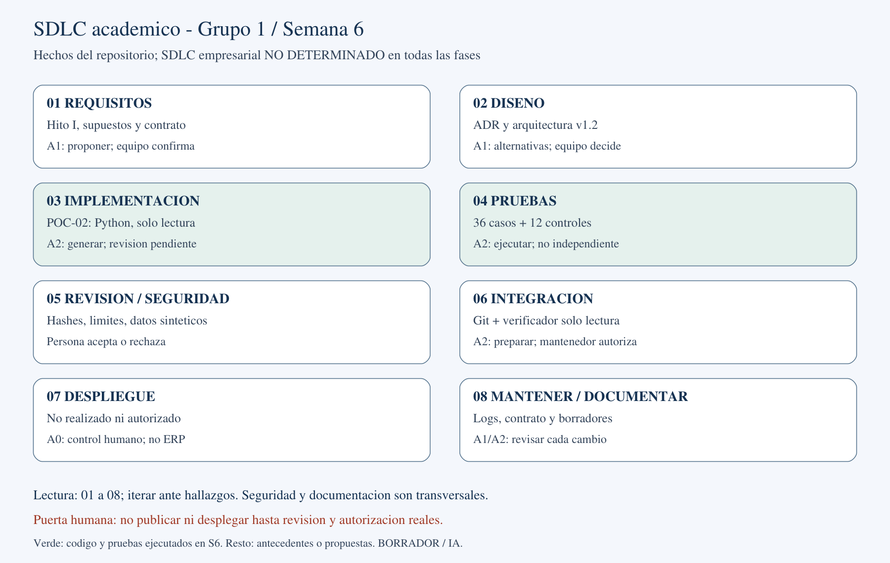

# Semana 6 — AI-Native SDLC y productividad

**BORRADOR v0.1 — PENDIENTE DE VALIDACIÓN HUMANA**

Universidad Nacional Mayor de San Marcos. Facultad de Ingeniería de Sistemas e Informática. Escuela de Ingeniería de Software.
Curso: Tendencias en Ingeniería de Software y Gestión. Docente: Mg. PMP Yamil Quiñones Nieto.
Grupo 1 · Periodo 2026-2 · Fecha: 26/10/2026 · Peso curricular S6: 6 %, no calificación.
Integrantes: Anthony Romani, Max Astuhuaman, Guillermo Calle y Pablo Mendoza.
Caso ficticio: Constructora Andina S.A.C. Elaboración con IA; responsabilidad y revisión académica del equipo pendientes.

## 1. Resumen ejecutivo

Se desarrolló POC-02, un validador Python de costos y metrados sintéticos previo a staging. La primera versión superó 48 pruebas automatizadas: 36 casos de aceptación públicos y 12 controles técnicos; no hubo fallos ni correcciones de implementación. Los originales contienen 35 filas por archivo y permanecieron intactos. En el corpus hubo cero falsas aceptaciones de 28 entradas inválidas y cero falsos rechazos de 8 válidas. Estos resultados no prueban ausencia universal de defectos ni calidad empresarial.

El mismo asistente diseñó contrato, pruebas y código: evaluación no ciega y no independiente. No hubo condición manual, cronometraje humano ni revisión real del equipo. El ahorro y el tiempo total hasta aceptación humana son NO DETERMINADOS. Se propone uso A2 en entorno local con autorización humana antes de publicar. El paquete es borrador interno y no está listo para entrega académica aprobada sin esa revisión.

## 2. Introducción y continuidad con el Hito I

El [Hito I v1.2](Semana5_Hito_I_v1.2.md) conserva CodeIgniter/MySQL y propone ERP → extracción autorizada → staging/validación → transformación SQL/Python → almacenamiento analítico → BI → revisión humana. POC-02 concreta una comprobación local de calidad previa a staging; no implementa esa cadena completa, ni reemplaza el ERP. No se observaron código, infraestructura o procesos empresariales reales. Los diagramas [AS-IS](../../arquitectura/revision-v1.2/figura-01-arquitectura-as-is.svg) y [TO-BE](../../arquitectura/revision-v1.2/figura-03-arquitectura-to-be-v0-1.svg) siguen vigentes sin regeneración.

La guía oficial p. 8 exige PoC o comparación, métricas, mapa y supervisión; pp. 3 y 14–15 requieren fuentes pertinentes, contribuciones y revisión humana. No exige demostrar superioridad de la IA. La ausencia de comparación es una limitación explícita, no evidencia de ahorro nulo ni positivo.

## 3. Problema y objetivo S6

Los históricos del escenario no se reutilizan de forma integrada para presupuestación/control. Antes de estimar o visualizar, deben detectarse IDs vacíos, números inválidos, duplicados y relaciones incompletas. Objetivo S6: evaluar el aporte de un agente a producir y comprobar un componente pequeño con requisitos explícitos, evidencia reproducible y límites de decisión. No se evalúa adopción masiva, valor monetario o desempeño humano causal.

## 4. Mapa del SDLC actual: evidencia, desconocidos y propuesta

El AS-IS siguiente describe el repositorio académico; **el SDLC empresarial es NO DETERMINADO en todas las fases**. La arquitectura empresarial documentada es un escenario, no una inspección. Las oportunidades son propuestas; solo el validador, sus pruebas y esta documentación se ejecutaron en S6.

Fuente editable propia: [SVG](../../arquitectura/semana-06/mapa-sdlc.svg); exportación [PDF](../../arquitectura/semana-06/mapa-sdlc.pdf). Elaboración asistida por IA, revisión humana pendiente.

| Fase | Evidencia académica actual | Oportunidad / beneficio potencial | Riesgo / control humano |
|---|---|---|---|
| Requisitos | Hito I §§2–3, supuestos y DT | IA propone criterios comprobables | Inventar necesidades; equipo confirma con custodio |
| Diseño | Hito I §6, ADR y diagramas v1.2 | Comparar alternativas y contratos | Sobrediseño; arquitecto valida trade-offs |
| Implementación | POC-01 conservada; POC-02 src | Generar validador acotado | Código plausible incorrecto; revisión y contrato |
| Pruebas | POC-02 pruebas y S6-001 | Proponer fronteras y automatizar | Sesgo compartido; evaluación humana adicional |
| Revisión | Auditorías S1–S5; revisión S6 pendiente | IA señala inconsistencias | Autocertificación; persona decide aceptar/rechazar |
| Seguridad | CONTRIBUTING y exclusión de secretos | Revisar dependencias y entradas | Filtrar datos; solo sintéticos y lectura local |
| Integración | Git y verificador seguro; sin workflow CI versionado | Preparar check automatizado | Efectos secundarios; revisar scripts antes de integrar |
| Despliegue | No hay despliegue ERP demostrado | Preparar checklist, no desplegar | Impacto productivo; TI autoriza fuera de esta PoC |
| Mantenimiento | PREPARACION_SEMANA_06 y manifiestos | Analizar regresiones/cambios | Deriva de contrato; versionar y aprobar enmiendas |
| Documentación | Markdown, registros y exportaciones | Sintetizar evidencias y fuentes | Citas falsas/atribución; lectura de fuentes y revisión |

## 5. Oportunidades de IA por fase

La IA puede acelerar propuestas de criterios, alternativas de diseño y fixtures; esa utilidad es potencial salvo las actividades ejecutadas aquí. En integración conviene primero una comprobación local de solo lectura, no una plataforma compleja. En despliegue y operación debe limitarse a preparar instrucciones; no dispone de acceso ni autorización para ejecutar cambios empresariales. DORA (2025) contextualiza que la IA amplifica condiciones del sistema: una buena salida aislada no sustituye contratos, pruebas y decisiones humanas.

## 6. Matriz de autonomía, riesgos y revisión

Convención académica propuesta, no estándar literal de la guía: A0 trabajo humano sin IA generativa; A1 IA propone y humano decide/aplica; A2 IA produce en entorno aislado y humano revisa/autoriza; A3 ejecución o publicación autónoma. POC-02 usa **A2 para producción local de artefactos**, con revisión posterior pendiente. Aislamiento significa aquí separación de destinos y ausencia de producción; no una sandbox de seguridad ni aislamiento del evaluador. No se declara completado el ciclo de autorización humana A2.

| Tarea / nivel | Riesgo técnico, privacidad y deuda | Mitigación | Responsable humano / aceptación |
|---|---|---|---|
| Requisitos / A1 | Reglas inventadas; contexto sensible; ambigüedad | Datos autorizados, criterios trazables | Equipo + custodio: confirmar significado y alcance |
| Diseño / A1 | Productos innecesarios; detalles internos; acoplamiento | Mantener ERP, ADR explícitos | Responsable arquitectura: aprobar alternativas |
| Código / A2 | Parser incorrecto; fuga en mensajes; formatos rígidos | Decimal, límites, solo lectura | Revisor técnico: contrato y suite más lectura |
| Pruebas / A2 | Casos sesgados; fixtures privados; mantenimiento duplicado | Casos congelados sintéticos, nuevo revisor | QA del equipo: reproducir y añadir evaluación posterior |
| Revisión / A1 | IA aprueba su propio error; exposición de código; deuda oculta | Separar decisión humana, registrar hallazgos | Revisor distinto si disponible: aceptar o rechazar |
| Seguridad / A1 | Enlaces/carreras; datos confidenciales; falsa garantía | Uso local, sin secretos, no servicio público | TI/custodio: autorizar datos y modelo de amenaza |
| Integración / A2 | Escritura histórica; logs con datos; scripts opacos | ID exclusivo y verificador solo lectura | Mantenedor: revisar diff, hashes y exit codes |
| Despliegue / A0 | Interrupción ERP; credenciales; reversión no probada | Sin acceso productivo; plan separado | TI: autorización, backup y rollback reales |
| Mantenimiento / A1 | Romper contrato; nuevos datos privados; regresión | Enmiendas, pruebas y conservación | Mantenedor: revisión de nueva versión |
| Documentación / A2 | Métricas/citas falsas; nombres no autorizados; desactualización | Fuentes originales, evidencia enlazada | Todo el equipo: comprobar texto y defensa |
| Publicación/decisión económica / A0 | Aprobar sin evidencia; filtración; dependencia del agente | Prohibir A3 productivo/publicación final | Equipo/docente o responsable empresarial: aprobación real |

Los responsables son roles propuestos, no asignaciones ni revisiones ya realizadas. A3 no se recomienda para publicación o decisiones de negocio; ejecución automática de unittest no autoriza un despliegue.

## 7. Selección y justificación de POC-02

Se eligió validar costos/metrados porque usa campos existentes, tiene salida comprobable y aporta a ADR-03/04/06 sin acceder al ERP. Frente a estimación, RAG o APU, evita datos/etiquetas/tarifas inexistentes. El producto valida formato y relación, no veracidad económica. El éxito local reduce incertidumbre sobre implementabilidad, no demuestra beneficios monetarios.

## 8. Contrato funcional

El [contrato v1.0](../../poc/POC-02-ai-native-sdlc/CONTRATO.md) se congeló antes del código. API validar(costos: Path, metrados: Path) → dict; CLI JSON por stdout y exit 0 válido, 1 inválido, 2 argumentos incorrectos. CSV UTF-8/BOM con columnas exactas obra_id, partida_id, costo_real/cantidad, orden libre y extras únicas. IDs strip solo en memoria; números Decimal ASCII finitos >0. Límites locales: 1 MiB/archivo, 4096 caracteres/campo, 128/ID o número; no symlinks.

RF-01 columnas; RF-02 IDs; RF-03 formato/finitud; RF-04 positividad; RF-05 duplicados; RF-06 correspondencia; RF-07 archivos inválidos; RF-08 determinismo; RF-09 inmutabilidad; RF-10 estado claro. Un fallo estructural en cualquier archivo deshabilita correspondencias para evitar cascadas; errores numéricos no eliminan claves válidas. Diagnósticos ordenados por archivo lógico, fila, campo, código y mensaje; sin valores privados ni rutas.

## 9. Metodología e hipótesis funcional

H-S6-F: la primera implementación satisface todos los casos y controles definidos; se rechaza técnicamente si falla alguno. Es una hipótesis funcional acotada, no la hipótesis comparativa manual/IA del planteamiento anterior. La solicitud vigente excluye el brazo manual; no se simularon personas ni soluciones manuales. La aceptación técnica requiere todos los controles, originales intactos y CLI correcta. La aceptación humana permanece separada.

Secuencia registrada: contrato/protocolo/prompts/casos/suite → [congelación SHA-256](../../evidencias/semana-06/congelacion_previa.json) → implementación → [primera versión](../../evidencias/semana-06/primera_version/manifiesto.json) sin pruebas aún → corrida S6-001 → redacción. La congelación evita alterar esperados después del resultado, pero no garantiza independencia, fecha certificada ni ausencia de sesgo. No hay pruebas ocultas o custodio externo. Un revisor futuro debe evaluar como etapa posterior.

## 10. Herramientas y entorno

OpenCode 2.1.4; modelo declarado GPT-6.1 Sol; Python local 3.12.10, biblioteca estándar para PoC (csv, decimal, json, unittest, hashlib, pathlib y subprocess). Git 2.45.1. No se instaló nada. Sampling, semilla del modelo, tokens y costo monetario: NO DETERMINADOS. No hubo segunda API/modelo ni evaluador externo. ReportLab, python-docx y PyMuPDF preexistentes sirven solo para exportación/inspección documental, no son dependencias del validador.

## 11. Entradas, prompts y salidas conservadas

Entradas reales: [costos.csv](../../poc/POC-01-estimacion-historicos/datos/costos.csv), [metrados.csv](../../poc/POC-01-estimacion-historicos/datos/metrados.csv), contrato y corpus público. Ambos originales tienen 35 filas; solo se leyeron. Los [prompts](../../poc/POC-02-ai-native-sdlc/prompts.md) contienen extractos literales y contexto operativo, no transcripción íntegra de sesión. Primera fuente/suite/casos se conservaron antes de probar; la corrida copia fuente, suite, casos y runner con hashes.

Salida sobre originales: estado VALIDO, filas costos 35 y metrados 35, errores vacíos, exit 0. Véase [JSON CLI](../../poc/POC-02-ai-native-sdlc/resultados/S6-001/cli_stdout.json). El validador no escribe; el runner escribe únicamente una carpeta nueva con ID. No leyó verdad futura, catálogo de generación o resultados de estimación.

## 12. Pruebas ejecutadas y trazabilidad RF

[Resultado estructurado](../../poc/POC-02-ai-native-sdlc/resultados/S6-001/resultados.json), [log real](../../poc/POC-02-ai-native-sdlc/resultados/S6-001/unittest.log) y [casos CSV](../../poc/POC-02-ai-native-sdlc/resultados/S6-001/casos.csv). unittest aporta ejecución y registro de casos/resultados (Python Software Foundation, s. f.); pasar la suite no certifica requisitos no probados.

| Requisito | Casos/controles pertinentes | Resultado S6-001 |
|---|---|---|
| RF-01 | C03, C04, C17, C18, C31 | Verificado en corpus |
| RF-02 | C08, C13, C14, C36; técnico 06 | Verificado en corpus |
| RF-03 | C02, C05–C07, C22–C26, C34–C35; técnico 07 | Verificado en corpus |
| RF-04 | C09–C12; técnico 09 | Verificado en corpus |
| RF-05 | C15–C16 | Verificado en corpus |
| RF-06 | C13–C14, C27–C28, C36 | Verificado en corpus |
| RF-07 | C19–C21, C29–C33; técnicos 04,05,10,12 | Verificado en corpus |
| RF-08 | técnico 01,09 y estructura de 36 casos | Verificado en corpus |
| RF-09 | Hash por caso; técnicos 02–03; CLI e integridad | Verificado en alcance local |
| RF-10 | Estados de 36 casos; técnicos 08,11 | Verificado en corpus |

36 casos: 8 válidos, 28 inválidos. 12 controles técnicos adicionales. Total 48 tests, 48 OK, cero fallos, cero errores. Ninguno omitido. No se midió cobertura de ramas/líneas; la tabla es trazabilidad funcional, no cobertura exhaustiva. El control de enlace simbólico está implementado pero no tiene prueba portable específica en esta suite Windows.

## 13. Métricas de productividad observadas

| Métrica | Valor / unidad | Método y alcance |
|---|---|---|
| M1 total desarrollo hasta aceptación humana | NO DETERMINADO | Sin cronometraje humano completo ni aceptación |
| M1-t suite automática | 1,448975 s | perf_counter, una corrida local de 48 tests |
| M1-t CLI sobre originales | 0,178095 s | perf_counter, incluye subprocess, una corrida |
| M2 revisión humana | NO DETERMINADO | No se registró intervención de revisión |
| M3 retrabajo de implementación | 0 ciclos | Primera corrida pasó; no hubo correcciones de código |
| Iteraciones de evaluación funcional | 1 | S6-001; reproducción futura usa ID nuevo |
| M4 ahorro manual/IA | NO DETERMINADO | Sin Tmanual; no aplicar fórmula relativa |
| Requisitos implementados/verificados | 10/10 en alcance | RF-01–RF-10, matriz anterior |
| Estado | ACEPTACIÓN TÉCNICA LOCAL | Aprobación humana pendiente |

Los tiempos no abarcan toda la lectura, prompts, espera, desarrollo, redacción o revisión: no son M1 humano ni permiten medir productividad laboral. Recuentos de requisitos/correcciones describen el proceso, no ahorro. Si existiera comparación válida, reducción = 100 × (Tmanual − TIA) / Tmanual, con Tmanual >0; aquí no se calcula. Las marcas UTC exactas de inicio/fin están en resultados.json y no acreditan intervalos humanos.

## 14. Métricas de calidad

| Indicador | Fórmula / denominador | Observado |
|---|---|---|
| Q1 aceptación de casos | 100 × casos estado/códigos/estructura correctos /36 | 36/36 = 100 % |
| Tests automatizados | 100 × tests OK /48 | 48/48 = 100 % |
| Q2 falsas aceptaciones | Inválidos aceptados /28 | 0/28 = 0 % |
| Q3 falsos rechazos | Válidos rechazados /8 | 0/8 = 0 % |
| Q4 RF trazados | RF con comprobaciones satisfechas /10 | 10/10 en corpus, no aprobación académica |
| Q5 defectos confirmados por suite | Fallos atribuibles al validador en S6-001 | 0 detectados; no garantía universal |

Los porcentajes describen el corpus público. No son una estimación poblacional ni prueba de superioridad frente a otra implementación. Q1 no mezcla 36 escenarios con los 12 controles; Q2/Q3 usan denominadores distintos. Inmutabilidad se comprobó en cada caso y sobre originales; la conservación general se contrasta contra el manifiesto inicial, con README como única edición de navegación autorizada.

## 15. Resultados auténticos y decisión técnica

La primera versión satisfizo H-S6-F bajo la suite definida: no se rechaza la hipótesis funcional en este corpus. No hubo versiones correctivas ni comparación antes/después porque no existieron defectos observados que corregir. La aceptación técnica registrada por el runner no implica que la persona responsable haya aceptado el resultado. Un número finito positivo puede seguir siendo económicamente erróneo; el software no valida unidades, monedas, rendimientos ni catálogos.

## 16. Evaluación humana y diseño de supervisión

**PENDIENTE DE VALIDACIÓN HUMANA.** El [instrumento](../../evidencias/semana-06/revision_humana.md) solicita identidad, intervalos reales, hashes, reproducción, hallazgos y decisión justificada. El equipo debe leer código y fuentes, reproducir con otro ID, comprobar métricas y explicar casos frontera. La inspección IA no se registra como revisión estudiantil. La guía exige revisión de material generado antes de presentarlo; por tanto, el paquete no se considera entrega final aprobada.

## 17. Discusión crítica y amenazas a la validez

Validez interna: mismo agente diseña y evalúa, conoce todas las expectativas; congelar reduce ajuste retrospectivo pero no ese sesgo. Constructo: duración de unittest no representa productividad de desarrollo; recuentos funcionales no representan valor empresarial. Validez externa: caso pequeño, sintético, modelo y entorno únicos, sin ERP o datos productivos. Reproducibilidad: artefactos y hashes permiten repetir el software, no reconstruir determinísticamente una respuesta del modelo sin sampling/transcripción completos.

Becker et al. (2026) explican problemas de selección y registro temporal al medir productividad; esto refuerza no convertir un cronómetro automático en resultado laboral. No se extrapolan porcentajes METR ni históricos POC-01. No hay participantes/condiciones comparables, inferencia causal, significancia estadística ni benchmark de modelos. DORA (2025) aporta contexto, no valida esta implementación.

## 18. Riesgos técnicos, privacidad, deuda y dependencia

Riesgo técnico: casos no cubiertos, límites de Decimal/CSV, enlaces/carreras del filesystem y archivos mutados durante lectura. Controles: límites, parser estricto, solo lectura y rechazo claro; no es un servicio endurecido para adversarios. No se afirma prevención completa de TOCTOU o consumo hostil. CSV con números localizados se rechaza deliberadamente: requiere transformación autorizada futura.

Privacidad: solo fixtures/originales sintéticos; no ERP, API externa de datos, credenciales o capturas empresariales. El modelo recibió contexto académico; no inferir autorización para enviar datos reales. Mensajes no reproducen valores/rutas. El escaneo de patrones es una comprobación limitada, no certificación de ausencia de secretos.

Deuda técnica nueva: reglas de dominio incompletas, falta de prueba específica de symlink, corpus público pequeño, ausencia de evaluación independiente, contrato no aprobado y no integración/CI. Mitigar con custodio de datos, nuevos tests versionados y revisión. Dependencia: sin servicio IA en runtime, bibliotecas estándar; el equipo debe poder mantener el código sin pedir al modelo que lo explique como única fuente. SSDF recomienda integrar prácticas seguras al ciclo, no delegar responsabilidad en herramientas (Souppaya et al., 2022).

## 19. Limitaciones y trabajo posterior

No se midieron esfuerzo humano, cobertura de ramas, confiabilidad en producción, carga concurrente, costo de modelo ni ahorro. No hubo pruebas reservadas, exportación íntegra de conversación o render Word/Excel. El DOCX se valida estructuralmente, no por paginación en Word; PDF tiene inspección separada registrada. Se requiere evaluación humana y, si se pretende estudiar productividad, un experimento nuevo con personas/tareas/tiempos reales. No se exige fabricar ese brazo para cerrar la PoC funcional.

## 20. Trazabilidad con decisiones, supuestos y deuda

| Antecedente | Aporte S6 | Pendiente / límite |
|---|---|---|
| ADR-03 SQL/Python versionados | Fuente y pruebas Python reproducibles | Integración y revisión de mantenedor |
| ADR-04 contrato/modelo | RF y claves costo/metrado explícitas | Custodio, unidades/monedas, semántica empresarial |
| ADR-06 pruebas/logs/revisión | 48 tests, resultados JSON/CSV, SHA-256 | Revisión humana auténtica |
| DT-01 históricos no comparables | Detecta inconsistencias básicas de forma/relación | No demuestra comparabilidad entre obras |
| DT-02 definiciones | Reglas documentadas antes del código | Aprobación del diccionario de negocio |
| DT-07 error poco visible supuesto | Diagnósticos estables/estado CLI | No integra alertas empresariales |
| DT-08 prácticas no inventariadas | Evidencia académica automatizada S6 | No prueba inventario del ERP |
| S-08 / S-24 y desconocidos del Hito | Continúan como antecedentes/definiciones pendientes | No se cierran supuestos por pasar tests |

Nuevas decisiones y contribuciones: [Registro S6](../../gestion/registros/Registro_Semana6_v0.1.md). No cambia ADR-01 ni ADR-02, no reabre Hito I silenciosamente, no declara resueltas DT completas.

## 21. Evolución futura hacia presupuestos APU

APU permitiría desglosar una partida/actividad en mano de obra (horas, categorías, tarifas, rendimientos), materiales (cantidades, precios, desperdicios) y equipos (horas y tarifas), vinculados al metrado y a históricos comparables. Así podría explicarse un presupuesto y contrastarlo con ejecución. Para ello se necesitan unidades, vigencia de tarifas, fuentes autorizadas, recursos y reglas de agregación/calidad. POC-02 solo aporta una puerta de validación inicial de dos archivos; no integra esos recursos, no calcula APU y no inventa materiales, trabajadores, tarifas o precios. La evolución requiere contrato y aprobación separados.

## 22. Conclusiones

POC-02 demuestra implementabilidad y cumplimiento técnico local de un contrato pequeño: 36 casos y 12 controles superados en la primera versión, originales preservados y diagnósticos reproducibles. No demuestra que IA reduzca tiempo humano ni que los datos sean económicamente correctos. La utilidad observada es producir artefactos verificables; su aceptación y mantenimiento requieren comprensión humana. Se recomienda revisar el borrador y ampliar evaluación antes de integrar, sin despliegue autónomo ni cierre ficticio de deuda.

## 23. Referencias APA 7

Becker, J., Rush, N., Cunningham, T., Rein, D., & Mahamud, K. (2026, 24 de febrero). *We are changing our developer productivity experiment design*. METR. https://metr.org/blog/2026-02-24-uplift-update/

DORA. (2025). *State of AI-assisted software development* [Página de presentación del informe 2025]. https://dora.dev/research/2025/dora-report/

Python Software Foundation. (s. f.). *unittest — Unit testing framework*. Python 3.12 documentation. Recuperado el 26 de octubre de 2026, de https://docs.python.org/3.12/library/unittest.html

Souppaya, M., Scarfone, K., & Dodson, D. (2022). *Secure Software Development Framework (SSDF) version 1.1: Recommendations for mitigating the risk of software vulnerabilities* (NIST SP 800-218). National Institute of Standards and Technology. https://doi.org/10.6028/NIST.SP.800-218

Verificación de identidad/fecha/alcance y nivel de las fuentes: [registro bibliográfico S6](../../fuentes/semana-06/VERIFICACION_FUENTES.md). NIST nivel 1 satisface mínimo cualificado; cuatro fuentes pertinentes en total. DORA se consultó como página/resumen, no como informe íntegro; METR es complemento metodológico, no artículo arbitrado. La guía y el Hito son autoridades internas, no se cuentan como las tres fuentes externas.

## 24. Declaración de uso de IA y conservación

OpenCode/GPT-6.1 Sol generó contrato, código, pruebas, texto y diagramas; ejecutó herramientas y verificaciones en esta sesión. No se atribuye esa producción a programación manual estudiantil. El registro de prompts conserva extractos, no la conversación íntegra. No se hicieron commits/push ni se regeneró POC-01. Inventario inicial de 170 archivos y verificaciones finales documentan conservación; README solo añade navegación S6. SHA-256 acredita consistencia local, no autoría, aprobación o sello de tiempo independiente.

## 25. Contribuciones y preparación para entrega

Los integrantes están identificados por el Hito I; sus contribuciones S6 individuales no están acreditadas y no se inventan. El usuario definió alcance/restricciones; el asistente produjo los artefactos. El equipo deberá registrar actividad, fecha y evidencia real, revisar fuentes/código/diagramas y confirmar capacidad de defensa de todos. Véanse [contribuciones](../../gestion/registros/Registro_Semana6_v0.1.md), [revisión](../../evidencias/semana-06/revision_humana.md) y [auditoría](../../evidencias/semana-06/AUDITORIA_S6_v0.1.md).

Veredicto: **parte técnica y documental preparada como borrador; NO APROBADA para entrega final sin revisión humana**. La comparación de productividad no es verificable con este diseño. La guía prevalece sobre el resultado de cualquier script.
