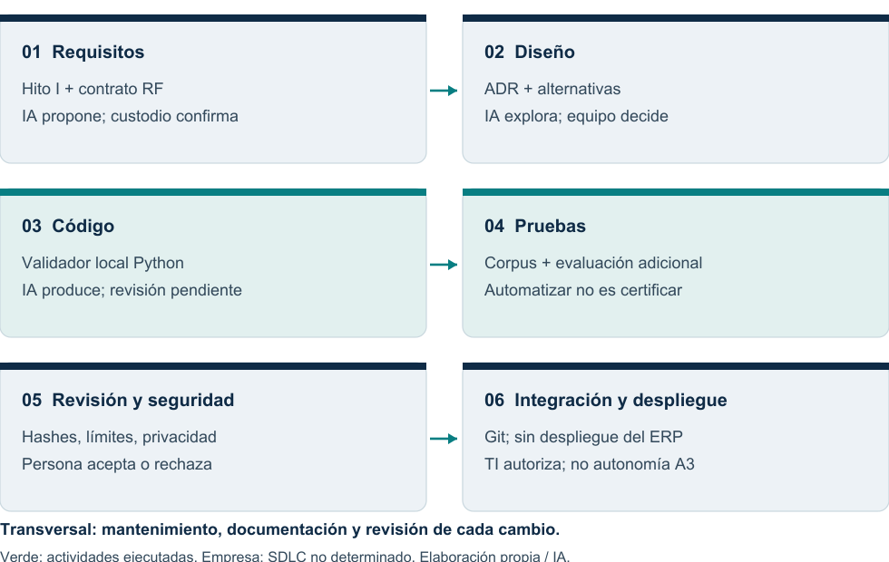
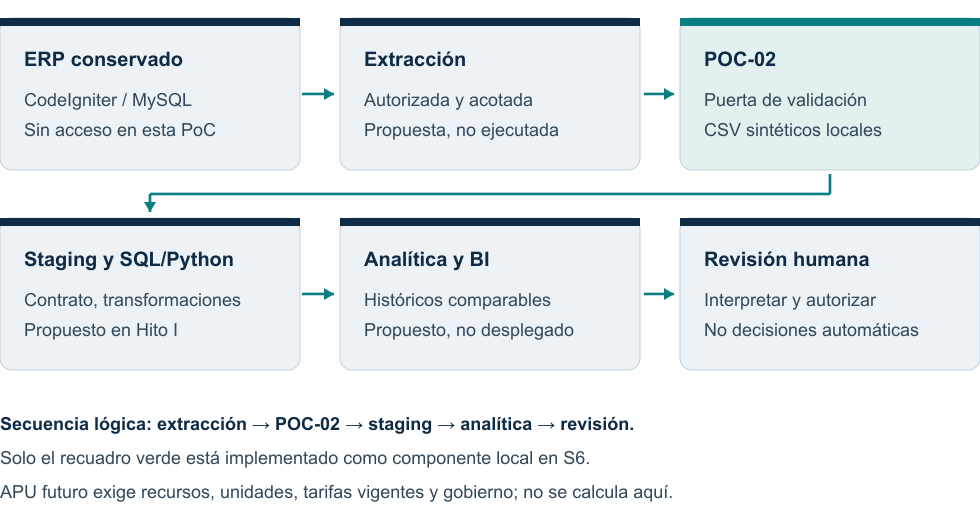
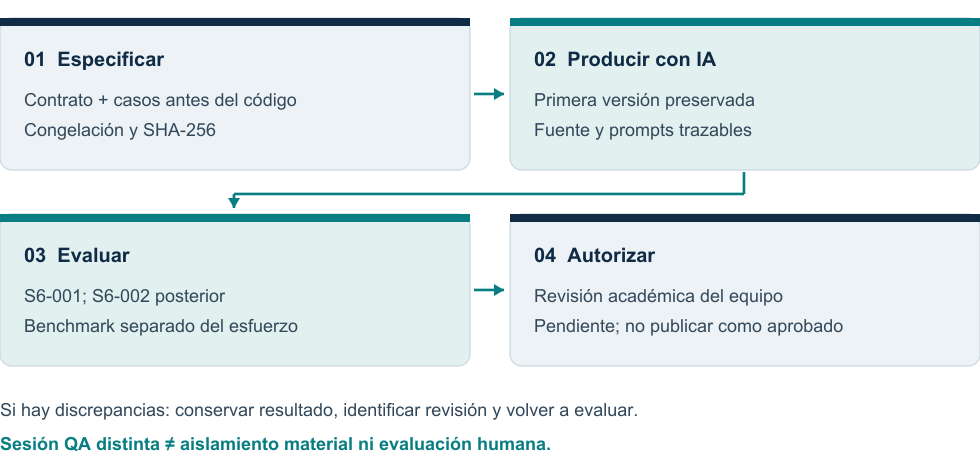

# AI-Native SDLC

## Semana 6 · Productividad y calidad

**Universidad Nacional Mayor de San Marcos**

Facultad de Ingeniería de Sistemas e Informática

Escuela de Ingeniería de Software

Curso: Tendencias en Ingeniería de Software y Gestión

### Una puerta de calidad para los datos de obra

Caso académico ficticio: Constructora Andina S.A.C.

**Grupo 1**

Anthony Romani · Max Astuhuaman · Guillermo Calle · Pablo Mendoza

Docente: Mg. PMP Yamil Quiñones Nieto

Periodo: 2026-2 · Fecha: 26 de octubre de 2026 · Revisión v0.2

> BORRADOR — pendiente de revisión del equipo. Peso curricular S6: 6 %, no calificación. Elaboración asistida por IA; sin aceptación humana registrada.

La v0.1 se conserva como antecedente. Esta revisión añade evaluación técnica posterior, mediciones de rendimiento y un rediseño editorial; no reconstruye tiempos humanos pasados ni modifica S6-001.

<!-- pagebreak -->

## 01 / Resumen ejecutivo

### El problema y la contribución

El escenario de Constructora Andina necesita reutilizar históricos para presupuestación y control. Antes de comparar obras, debe detectar datos vacíos, números inválidos, claves repetidas y relaciones incompletas. POC-02 implementa esa puerta inicial: un validador local Python de costos y metrados sintéticos, sin acceso al ERP ni cálculo de presupuestos.

La IA intervino en requisitos verificables, diseño del contrato, implementación, pruebas y documentación. El objeto de evaluación no es solo código: es la trazabilidad entre una instrucción, un artefacto generado, sus comprobaciones y la decisión humana que aún debe adoptarse. Esta es una aplicación acotada de AI-Native SDLC, no IA operacional tomando decisiones empresariales.

| Evidencia | Resultado y lectura correcta |
|---|---|
| S6-001, histórico intacto | 48/48 tests: 36 casos y 12 controles. Sin correcciones iniciales. |
| Evaluación posterior | S6-002: 0/35 bruto por dos defectos del arnés. S6-003: 35/35 con arnés corregido; mismo validador. |
| Rendimiento técnico | API de 35 filas: mediana 0,896 ms; CLI: 136,781 ms. Treinta repeticiones; no productividad laboral. |
| Decisión académica | BORRADOR; revisión del equipo y aportes individuales pendientes. |

### Qué puede y qué no puede concluirse

Se dispone de una capacidad ejecutable con criterios y salidas reproducibles. No se demuestra ahorro humano, superioridad frente a desarrollo manual, veracidad económica de los datos o seguridad productiva. La aceptación de casos conocidos no equivale a certificación del software.

> Tiempo total de desarrollo asistido, revisión humana y ahorro: NO DETERMINADOS. No existe línea base manual ni cronometraje integral desde el inicio.

**Ruta de lectura:** SDLC y autonomía (03–04), arquitectura y método (05–06), evidencia y resultados (07–09), riesgos, conclusiones y fuentes (10–12). Los números remiten a páginas, no a requisitos nuevos del docente.

<!-- pagebreak -->

## 02 / Mapa del SDLC y oportunidades de IA

El mapa describe hechos del **repositorio académico**, no observaciones del proceso empresarial. El SDLC del ERP real es NO DETERMINADO en todas las fases. Se mantienen los diagramas históricos AS-IS/TO-BE y los supuestos del Hito I v1.2; no se infieren prácticas empresariales a partir de esta PoC.



| Fase transversal | Evidencia actual / oportunidad propuesta |
|---|---|
| Requisitos y diseño | Hito I, supuestos y ADR: IA propone criterios/alternativas; custodio y arquitecto confirman significado. |
| Código y pruebas | POC-02, corpus congelado y evaluaciones: generar en entorno local y comprobar salidas; no autoaprobar. |
| Integración y operación | Git y verificador seguro; sin workflow CI o despliegue ERP demostrado. IA puede preparar checks y procedimientos, no ejecutarlos en producción. |
| Mantenimiento/documentación | Contratos, logs y versiones: detectar regresiones, sintetizar evidencia y revisar cada cambio humano. |

El beneficio potencial es reducir fricción al proponer artefactos; no se cuantificó esfuerzo evitado. DORA (2025) presenta la IA como amplificador de fortalezas y debilidades organizacionales: contratos y revisión siguen siendo necesarios.

<!-- pagebreak -->

## 03 / Autonomía supervisada

Escala académica propuesta, no estándar literal de la guía: **A0** trabajo humano; **A1** IA propone y humano decide; **A2** IA produce localmente y humano revisa/autoriza; **A3** ejecución o publicación autónoma. POC-02 aplica producción local A2 con aprobación posterior pendiente. Separar destinos no es una sandbox de seguridad ni aislamiento del evaluador.

| Tarea / nivel | Riesgo principal | Control | Revisión y criterio humano |
|---|---|---|---|
| Requisitos / A1 | Reglas inventadas; datos sensibles | Criterios trazables y contexto autorizado | Custodio: confirmar definiciones |
| Diseño / A1 | Sobrediseño y acoplamiento | Mantener ERP; justificar ADR | Arquitecto: aprobar trade-offs |
| Código / A2 | Parser plausible pero erróneo | Contrato, límites y pruebas | Técnico: leer fuente y reproducir |
| Pruebas / A2 | Sesgo compartido y casos insuficientes | Congelar esperados y otra sesión QA | QA: contrastar contrato y discrepancias |
| Revisión / A1 | Autocertificación por IA | Decisión separada y hallazgos | Persona: aceptar o rechazar |
| Seguridad / A1 | Filtración o falsa garantía | Solo sintéticos; sin producción | TI/custodio: autorizar datos |
| Integración / A2 | Sobrescribir históricos | ID exclusivo y hashes | Mantenedor: revisar diff/exit |
| Despliegue / A0 | Interrupción del ERP | No ejecutar en esta PoC | TI: autorización y reversión |
| Mantenimiento / A1 | Deriva de contrato/deuda | Enmiendas y regresión | Mantenedor: aprobar nueva versión |
| Documentación / A2 | Citas o métricas falsas | Fuente original y evidencia | Equipo: comprobar y defender |
| Publicación / A0 | Aprobar sin evidencia | Bloqueo hasta revisión real | Equipo/docente: aceptación auténtica |

Los responsables son roles propuestos, no personas que ya revisaron. **A3 no se autoriza para producción, publicación final ni decisiones económicas.** Ejecutar automáticamente pruebas no sustituye la responsabilidad académica individual.

<!-- pagebreak -->

## 04 / Del Hito I a una puerta de calidad

Se conserva CodeIgniter/MySQL. POC-02 valida dos CSV antes de una eventual carga analítica; no extrae del ERP, escribe staging, transforma históricos ni despliega BI. La actividad se eligió por sus campos reales disponibles y resultados comprobables, sin inventar recursos o etiquetas.



| Decisión / deuda | Contribución S6 | Lo que sigue pendiente |
|---|---|---|
| ADR-03 / DT-08 | Python y controles reproducibles | Revisión e integración del mantenedor |
| ADR-04 / DT-01, DT-02 | Contrato, claves y correspondencia | Unidades, monedas y comparabilidad real |
| ADR-06 / DT-07 | Estado, diagnósticos, logs y hashes | Alertas y revisión humana empresarial |

### Contrato pequeño y explícito

API `validar(costos: Path, metrados: Path) -> dict`; CLI JSON: exit 0 válido, 1 inválido, 2 uso incorrecto. CSV UTF-8/BOM, columnas exactas y orden libre. IDs normalizados solo en memoria; valores Decimal ASCII finitos y positivos. Duplicados y claves sin pareja invalidan la entrada.

Límites locales: 1 MiB/archivo, 4096 caracteres/campo y 128/ID o número; sin symlinks. Fallos estructurales deshabilitan correspondencias para evitar cascadas. Mensajes ordenados, sin valores privados ni rutas. Estos son controles del contrato, no garantías de calidad económica.

<!-- pagebreak -->

## 05 / Desarrollo con IA y método de evaluación

Herramienta declarada: OpenCode 2.1.4; modelo GPT-6.1 Sol; Python 3.12.10. La PoC usa biblioteca estándar y no necesita IA en runtime. No se instalaron dependencias. Sampling, semilla del modelo, tokens y costo: NO DETERMINADOS. Las bibliotecas documentales solo exportan/renderizan; unittest sustenta el registro automatizado (Python Software Foundation, s. f.).



### Dos etapas, sin reescritura retrospectiva

**S6-001:** contrato/protocolo/casos/suite congelados antes del código; primera versión conservada; 48/48 tests. H-S6-F se limita a satisfacer ese corpus. No hubo fallos o retrabajo iniciales; no se inventa una comparación antes/después.

**S6-002:** evaluación técnica automatizada adicional, posterior a la implementación. Una sesión QA con contexto inicial distinto recibió contrato y corpus previo para evitar duplicaciones, con instrucción de congelar esperados antes de leer/ejecutar la fuente. Las reglas por caso justifican expectativas, no una segunda opinión humana.

La sesión comparte filesystem, proveedor/herramienta y familia de modelo. No hubo permisos de ocultación de fuente ni custodio independiente; **no es una evaluación ciega o totalmente independiente**. S6-002 se congeló antes de observar la fuente; su corrección posterior ya conoce las salidas. El benchmark es otra operación y sus repeticiones no cuentan como nuevos casos funcionales.

> Aceptación técnica ≠ aprobación académica. Un hallazgo posterior debe conservarse y corregirse en una revisión identificada, nunca cambiando S6-001 o el contrato para favorecer la puntuación.

<!-- pagebreak -->

## 06 / Evidencia visible de ejecución real

Ejemplo inválido ejecutado sobre una copia byte a byte del validador original, con exit 1. Es una demostración visual, no otro caso puntuado. Los datos de metrado contienen la misma clave y cantidad 2.5. No se simula una captura de terminal.

### Entrada y comando efectivamente ejecutado

```csv
obra_id,partida_id,costo_real
OB-DEMO,P-01,-0.25
```

```text
python -X utf8 -B validador.py --costos costos.csv --metrados metrados.csv
```

### Respuesta real del CLI

```json
{
  "version_contrato": "1.0",
  "estado": "INVALIDO",
  "archivos": {
    "costos": {
      "filas": 1
    },
    "metrados": {
      "filas": 1
    }
  },
  "errores": [
    {
      "archivo": "costos",
      "fila": 2,
      "campo": "costo_real",
      "codigo": "E_NO_POSITIVO",
      "mensaje": "El valor debe ser estrictamente positivo."
    }
  ]
}
```

Procedencia: `evidencias/semana-06/revision-v0.2/ejemplo-cli/`: costos.csv, comando.txt, stdout.json y registro.json. Bloques transcritos de esos archivos; solo se normalizan terminadores de línea para maquetar, sin cambiar el contenido textual.

### Resumen histórico auténtico, no un resultado recreado

```text
Ran 48 tests in 1.435s

OK
```

Extracto exacto de las líneas 51–53 de `poc/POC-02-ai-native-sdlc/resultados/S6-001/unittest.log`. El tiempo interno del log y el envolvente perf_counter (1,448975 s) tienen fronteras distintas.

<!-- pagebreak -->

## 07 / Evaluación adicional y calidad

Se ampliaron fronteras de longitud, Unicode, decimales/exponentes, duplicados combinados, CSV multilínea y tamaño exacto de archivo. S6-002 conservó **0/35 bruto por dos errores del evaluador**. Tras corregir solo el arnés y la fila esperada de A20, S6-003 obtuvo **35/35 = 100 %**, con 10 válidos y 25 inválidos. **Q2: 0/25; Q3: 0/10.** No se detectaron defectos del validador.

Cada evaluación ejecutó 109 procesos: 35 escenarios ×3 seeds, tres controles CLI exit 2 y un symlink real. En S6-003, 35/35 escenarios fueron deterministas entre seeds. Son dos corridas sobre los mismos 35 escenarios, no 70 casos nuevos. A15/A28 conservan oráculos parcialmente ambiguos; el resultado no es validación contractual absoluta.

### Trazabilidad de requisitos a evidencia

| Requisito | Evidencia histórica | Ampliación posterior |
|---|---|---|
| RF-01 Columnas | C03–04, C17–18, C31 | A21–24: BOM, duplicadas y caja |
| RF-02 Identificadores | C08, C13–14, C36 | A01–07, A19: longitud y Unicode |
| RF-03 Números finitos | C02, C05–07, C22–26 | A08–13, A16: formato y exponentes |
| RF-04 Positividad | C09–12 | A11–12, A14: cero y signo |
| RF-05 Duplicados | C15–16 | A14–15, A17, A35: interacciones |
| RF-06 Correspondencia | C27–28, C13–14 | A06–07, A16, A20: claves/filas |
| RF-07 Archivo/CSV | C19–21, C29–33 | A25–34 y symlink real |
| RF-08 Determinismo | Control técnico 01 | Tres seeds por escenario |
| RF-09 Inmutabilidad | Hashes; controles 02–03 | Hashes de fuente, suite y fixtures |
| RF-10 Estado/CLI | 36 estados; controles 08,11 | Estados y CLI 0/1/2 |

Q1 = 100 × casos con expectativas satisfechas / casos evaluados. Q2 = inválidos aceptados / inválidos; Q3 = válidos rechazados / válidos. Los controles de CLI/determinismo/integridad se contabilizan aparte. No se suma todo bajo una tasa engañosa ni se mide cobertura de ramas por contar requisitos.

**Hallazgos:** EV-01 exigía contadores planos no impuestos por el contrato; EV-02 esperaba fila 5 donde el registro termina en la 4. Se realizó una iteración correctiva del arnés y cero correcciones del validador. El 0/35 inicial no son 35 falsos rechazos de datos: es fallo de la comprobación del evaluador. Dos ambigüedades (duplicados con ID inválido y código del límite de campo) siguen abiertas. Los 10 RF tienen evidencia pertinente, no cobertura exhaustiva.

<!-- pagebreak -->

## 08 / Rendimiento no es productividad humana

Se midieron dos cargas válidas: los originales de 35 filas/archivo y fixtures nuevos de 1000 filas/archivo. Treinta repeticiones por modo/tamaño, tras tres calentamientos; suite histórica de 48 tests repetida cinco veces tras un calentamiento. Todas las observaciones individuales se conservan. Mediana = centro ordenado; mínimo y máximo = extremos observados, sin intervalos de confianza.

| Grupo | n | Mediana (ms) | Mínimo (ms) | Máximo (ms) |
|---|---|---|---|---|
| API · 35 filas | 30 | 0,896 | 0,880 | 1,300 |
| CLI · 35 filas | 30 | 136,781 | 128,912 | 146,032 |
| API · 1000 filas | 30 | 10,759 | 10,304 | 26,563 |
| CLI · 1000 filas | 30 | 146,418 | 140,904 | 171,309 |
| Suite · 48 tests | 5 | 692,211 | 657,532 | 778,719 |

Fuente: `resultados/S6-BENCH-002/benchmark.json` y tiempos.csv, dentro de POC-02. Son 125 observaciones medidas, además de calentamientos excluidos del resumen. Unidades convertidas de segundos a milisegundos y redondeadas a tres decimales. Python 3.12.10 / Windows AMD64; parámetros y entorno íntegros en el JSON. La sesión QA había terminado antes de medir.

**API:** perf_counter rodea validar; incluye lectura/parser/diagnósticos, excluye importación. **CLI:** incluye arranque de intérprete, imports, lectura, JSON y captura por subprocess. La diferencia API–CLI no aísla únicamente el arranque. **Suite:** incluye fixtures, aserciones y subprocess de sus controles; no es latencia de una validación.

Orden fijo secuencial, cachés calientes y carga externa no controlada. No se fijaron afinidad ni frecuencia de CPU. La dispersión refleja este entorno Windows, no un SLA o benchmark empresarial. No debe compararse causalmente con la corrida única S6-001 ni extrapolarse a volúmenes mayores.

| Dimensión | Qué significaría | Estado en esta revisión |
|---|---|---|
| Productividad del desarrollador | Valor/calidad obtenidos frente al esfuerzo total | NO DETERMINADO: no se cronometró todo el proceso |
| Esfuerzo de revisión | Intervalos reales de lectura, prueba y decisión humana | NO DETERMINADO: equipo aún no revisó |
| Rendimiento del software | Tiempo para ejecutar una carga definida | Medido con repeticiones; no ahorro laboral |

Becker et al. (2026) discuten selección de tareas y dificultad de registrar tiempos con agentes concurrentes. Sus resultados no se transfieren a esta PoC. No hay Tmanual: no se calcula reducción relativa ni se usa cantidad de código como productividad.

<!-- pagebreak -->

## 09 / Riesgos, deuda y validez

AI-Native SDLC no significa sustituir todo el ciclo por generación: aquí aporta propuestas y artefactos comprobables, mientras mantiene decisiones de dominio, integración y publicación bajo control humano. La producción inicial correcta en un corpus conocido no resuelve el problema de confiar en código generado.

| Riesgo | Consecuencia | Control y límite residual |
|---|---|---|
| Oráculo sesgado | Código y pruebas comparten supuestos | Otra sesión y reglas por caso; sin independencia material |
| Formato ≠ significado | Un costo positivo puede ser falso | Custodio, unidades y catálogos futuros; no se valida economía |
| Entradas hostiles | Carreras, enlaces o agotamiento | Límites y solo lectura; no servicio endurecido ni garantía TOCTOU |
| Privacidad | Exponer históricos restringidos al modelo | Solo sintéticos; mensajes sin valores; no acceso ERP |
| Dependencia y deuda | Equipo incapaz de mantener reglas | Contrato, tests versionados y lectura humana; IA no es fuente de verdad |
| Deriva documental | Confundir corridas o atribuir aportes | Hashes y nuevas rutas; no reescribir resultados/autorías |

### Amenazas a la validez

**Interna:** la segunda sesión reduce contexto compartido inmediato, no garantiza un oráculo independiente. **De constructo:** tiempo de máquina no mide esfuerzo humano; Q1 no representa valor de negocio. **Externa:** dos cargas sintéticas, un entorno/modelo y ningún ERP productivo. **Reproducibilidad:** repetir el código es posible; regenerar idéntica respuesta del modelo no está garantizado sin configuración/transcripción completas.

SSDF integra prácticas de seguridad al SDLC, no certifica una PoC por pasar tests (Souppaya et al., 2022). La deuda pendiente incluye contrato no aprobado por custodio, evaluación humana ausente, semántica incompleta e integración/operación no realizadas. Las reglas no cierran por sí solas DT-01/02/07/08 ni supuestos S-08/S-24 del Hito I.

No se midió cobertura de líneas/ramas, seguridad adversarial, valor económico, costo del modelo o esfuerzo humano. El escaneo final de patrones de secretos es acotado; no certifica su ausencia universal.

<!-- pagebreak -->

## 10 / Evolución, conclusiones y decisión

### De validar a presupuestar por recursos

**Actual:** POC-02 comprueba columnas, IDs, números, claves y relaciones de dos CSV. **Propuesto en el TO-BE:** extracción autorizada, staging, históricos comparables, transformación analítica y BI bajo revisión. **Futuro:** APU que relacione mano de obra (horas-hombre, categorías, tarifas), materiales (cantidades, precios y desperdicio), equipos (horas y tarifas), metrados y rendimientos.

Con unidades, vigencia de tarifas y fuentes autorizadas, esos recursos podrían explicar costos unitarios por actividad/partida, presupuestos y desviaciones entre previsto y real. Nada de ello está calculado o integrado en S6. No se inventan materiales, trabajadores o precios. APU necesita contrato/modelo/gobierno nuevos y validaciones semánticas que esta PoC no proporciona.

### Conclusiones basadas en evidencia

**1. Capacidad técnica:** existe un componente local reproducible que aporta una puerta de calidad a ADR-03/04/06. Los resultados históricos y posteriores deben interpretarse con sus propios corpus y limitaciones.

**2. Aprendizaje del SDLC:** la IA produjo especificación, implementación, pruebas y documentación; el valor defendible es la trazabilidad verificable entre esas actividades, no el volumen de código ni una mejora laboral presupuesta.

**3. Supervisión:** congelar esperados y separar sesiones ayuda a auditar, pero no sustituye evaluación humana o independencia material. El equipo debe comprender las reglas y aceptar/rechazar el resultado.

**4. Límites:** no se demostró productividad comparativa, exactitud económica, seguridad productiva ni APU. El benchmark caracteriza ejecución, no justifica despliegue.

### Antes de presentar

- Reproducir en ID nuevo; revisar código, casos, métricas y fuentes.
- Leer el PDF completo y revisar DOCX en un procesador de texto.
- Registrar aportes individuales auténticos y tiempos reales de revisión.
- Emitir decisión aceptar/rechazar/condicionar y conservar sus evidencias.

> Estado final académico: BORRADOR — PENDIENTE DE VALIDACIÓN HUMANA. Ni los tests ni el rediseño editorial constituyen aprobación.

<!-- pagebreak -->

## 11 / Referencias y trazabilidad

### Referencias APA 7

Becker, J., Rush, N., Cunningham, T., Rein, D., & Mahamud, K. (2026, 24 de febrero). *We are changing our developer productivity experiment design*. METR. https://metr.org/blog/2026-02-24-uplift-update/

DORA. (2025). *State of AI-assisted software development* [Página de presentación del informe 2025]. https://dora.dev/research/2025/dora-report/

Python Software Foundation. (s. f.). *unittest — Unit testing framework*. Python 3.12 documentation. Recuperado el 26 de octubre de 2026, de https://docs.python.org/3.12/library/unittest.html

Souppaya, M., Scarfone, K., & Dodson, D. (2022). *Secure Software Development Framework (SSDF) version 1.1: Recommendations for mitigating the risk of software vulnerabilities* (NIST SP 800-218). National Institute of Standards and Technology. https://doi.org/10.6028/NIST.SP.800-218

NIST es nivel 1 según guía p. 3; se satisfacen cuatro fuentes pertinentes y una cualificada. DORA: solo página/resumen, no lectura íntegra del informe. METR: complemento metodológico, no artículo arbitrado. Python sustenta el arnés de pruebas, no productividad. Se conserva la verificación original y se reconfirmaron NIST/DORA/METR durante esta revisión.

### Anexos reproducibles del repositorio

| Artefacto | Procedencia y propósito |
|---|---|
| Contrato y primera versión | [POC-02](../../poc/POC-02-ai-native-sdlc/README.md); RF-01–RF-10 y prompts originales |
| Evaluación posterior | [S6-002](../../poc/POC-02-ai-native-sdlc/evaluacion_v02/README.md) y [corrección/S6-003](../../poc/POC-02-ai-native-sdlc/evaluacion_v02/revision-02/README.md); expectativas y hallazgos |
| Benchmark | [JSON](../../poc/POC-02-ai-native-sdlc/resultados/S6-BENCH-002/benchmark.json); parámetros y tiempos individuales |
| Mejoras y pendientes | [Registro v0.2](../../evidencias/semana-06/revision-v0.2/REGISTRO_REVISION.md) y [revisión del equipo](../../evidencias/semana-06/revision-v0.2/REVISION_EQUIPO.md) |
| Cumplimiento | [Auditoría v0.2](../../evidencias/semana-06/revision-v0.2/AUDITORIA_S6_v0.2.md); guía p. 8 y reglas transversales |

OpenCode/GPT-6.1 Sol generó código/texto/figuras y ejecutó herramientas; una sesión QA adicional produjo nuevos controles. No se atribuye programación manual ni revisión a los estudiantes. Los aportes individuales de los cuatro integrantes siguen pendientes de evidencia. Los prompts son extractos, no transcripción íntegra. No se hicieron commits/push ni se modificó v0.1, Hito I o POC-01. Hashes aportan consistencia local, no firma o aprobación.
